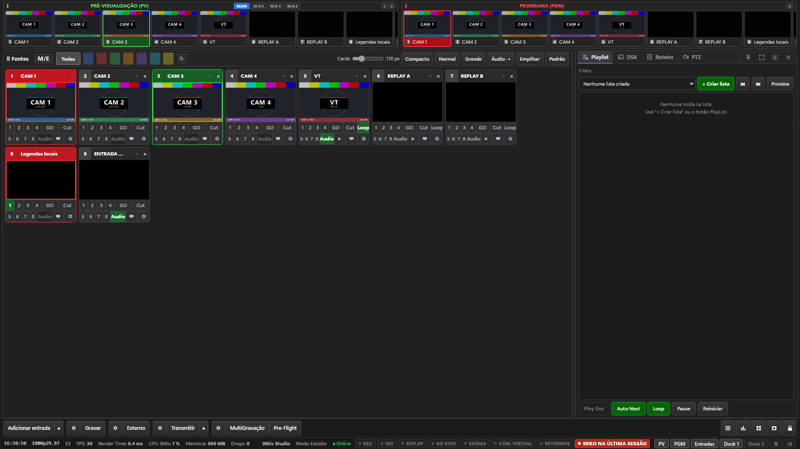
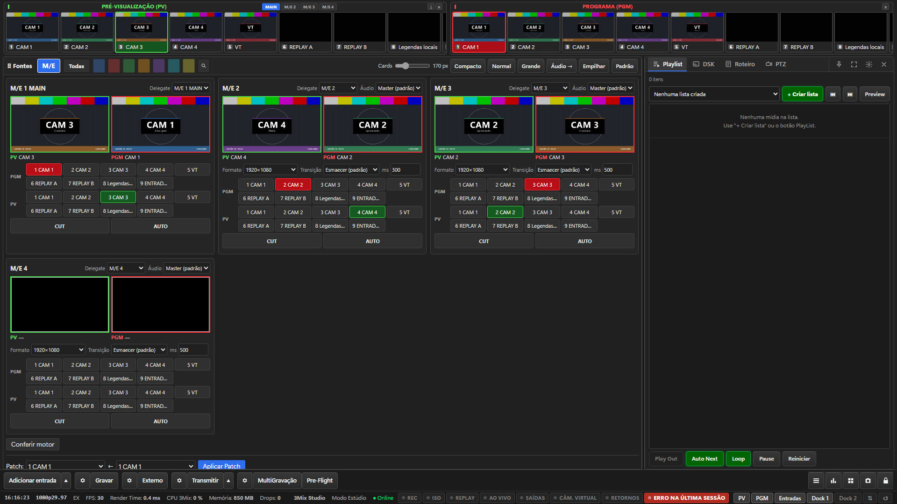
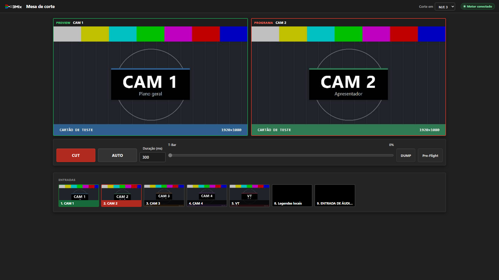
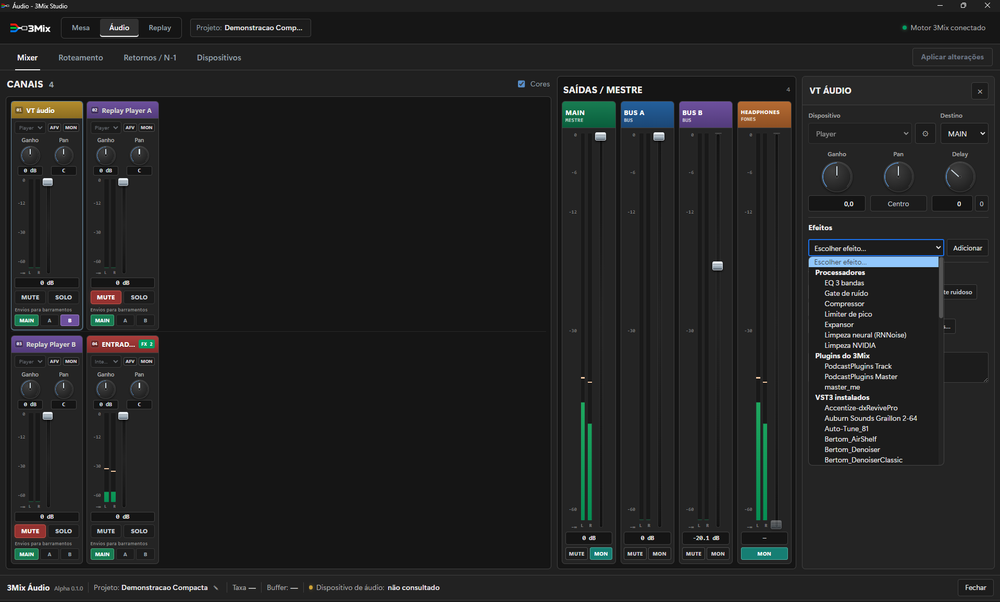
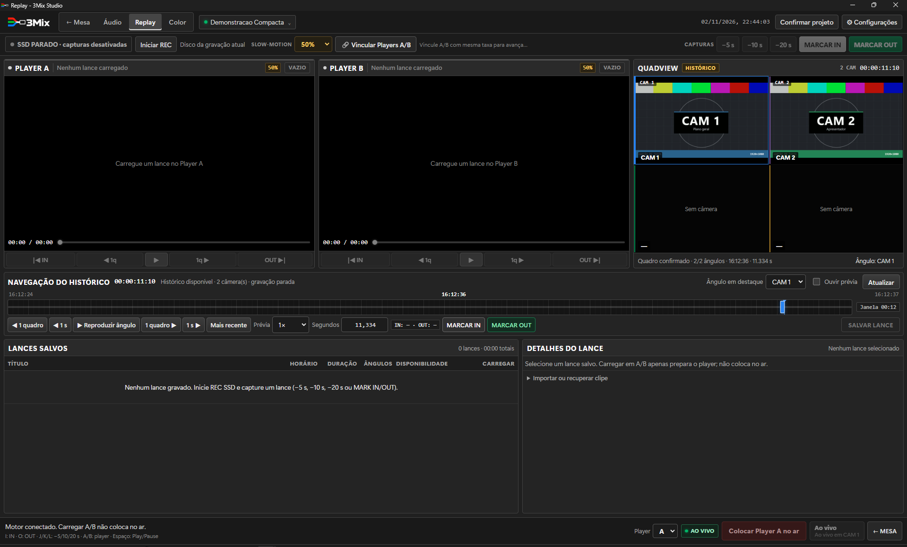
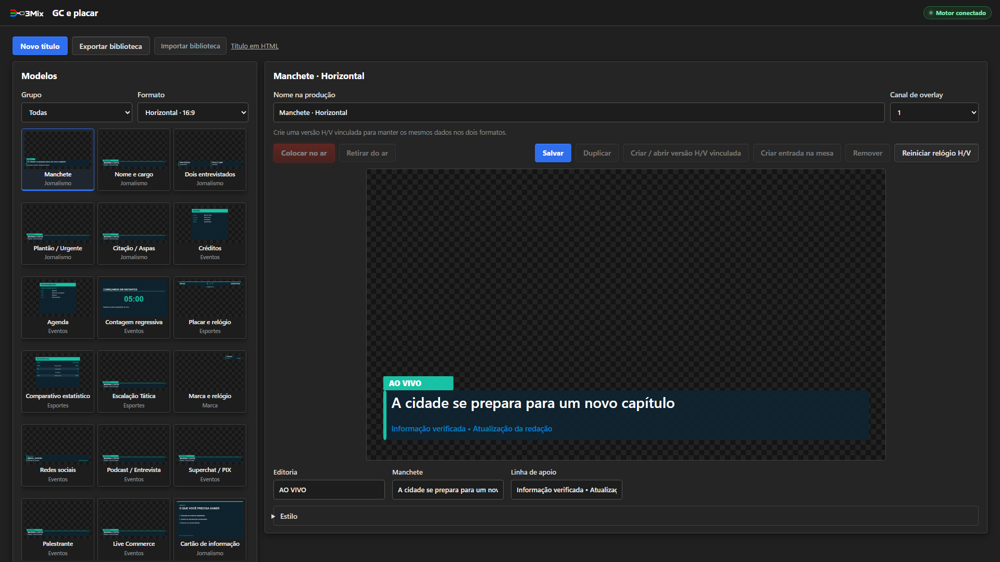
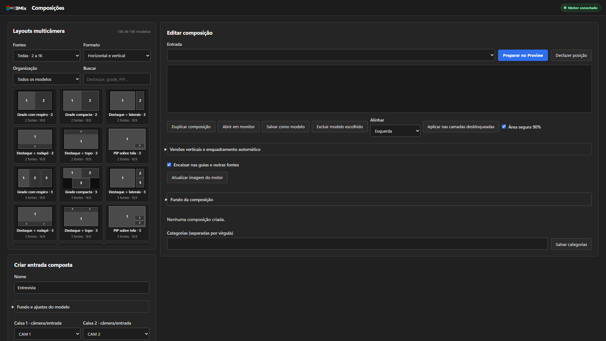
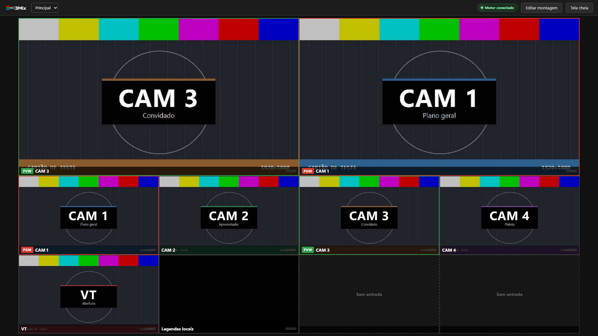

  

<h1 align="center">Produção broadcast, do input à saída</h1>

  <strong>Corte · Áudio · Composição · Gráficos · Replay</strong> 
  Painel operacional próprio e motor nativo baseado em OBS Studio/libobs.

  <a href="docs/GUIA-RAPIDO.md">Guia rápido</a> ·
  <a href="docs/PRODUCT-VISION.md">Visão do produto</a> ·
  <a href="docs/LEIA-ME-BETA.md">Instalação e beta</a> ·
  <a href="docs/LIMITES-CONHECIDOS.md">Limites conhecidos</a>

---

## Uma operação organizada em torno do input

O **3Mix** reúne vídeo, áudio, composição e controle operacional em cards e módulos dedicados. O input é a unidade central da produção, com superfícies para organizar sinais, preparar conteúdo e operar a mesa.

| Mesa e produção | Sinais e controle | Conteúdo e saídas |
|---|---|---|
| Corte e Multi-M/E | Patch e organização de inputs | Gráficos e DSK |
| Composição e camadas | Áudio por M/E | Playout e replay |
| Preview e Programa nativos | Painéis remotos | Gravação e transmissão |

Os módulos têm escopos de teste distintos; esta apresentação não implica homologação de todo hardware, rede ou fluxo de trabalho.

## Telas

Capturas do programa em execução, com o projeto de demonstração.

  

| | |
|---|---|
|  |  |
| **Multi-M/E:** Preview, Programa, formato e transição por M/E | **Mesa de corte:** em janela, no MAIN ou em qualquer M/E |
|  |  |
| **Áudio:** canais, barramentos e inspetor | **Replay:** Players A/B, Quadview e histórico |
|  |  |
| **GC e placar:** modelos com transparência | **Composições:** layouts multicâmera por slots |
|  | |
| **Multiview:** montagens com tally | |

## Estado da entrega

Projeto em desenvolvimento e qualificação. Este repositório contém fontes: um clone não é um instalador pronto. A beta completa ainda não possui aceite integral em Windows limpo.

- Multi-M/E: M/E 2 a 4 com corte, transição e formato próprios, Patch, saída como fonte e transmissão; testado no motor real, com os limites em [Limites conhecidos](docs/LIMITES-CONHECIDOS.md).
- Mesa, áudio, replay, composição, gráficos, saídas e operação remota têm escopos de teste distintos. Código presente não significa homologação de todo hardware ou rede.
- As imagens antigas em `screenshots/` são históricas e não representam a interface atual; não são apresentadas como capturas da entrega atual.

## Abrir no workspace de desenvolvimento

Use `INICIAR-3MIX.cmd` na raiz do workspace 3Mix. Não execute o binário nativo diretamente. O launcher prepara a instalação e conecta os serviços locais.

Estrutura canônica do workspace:

| Diretório | Finalidade |
|---|---|
| `3mix-panel/` (este repositório; alias `FreeMix/`) | Painel Web, API e ferramentas |
| `motor/` | Fontes do motor nativo, com os submódulos, neste repositório |
| `3mix-engine/` (alias `freemix-app/`) | Cópia de trabalho do motor, de onde `motor/` é atualizado |
| `3mix-runtime/` | Instalação portátil do operador |
| `qa-beta/` | Recibos e verificações locais |

## Documentação

- [Visão de produto](docs/PRODUCT-VISION.md)
- [Guia rápido](docs/GUIA-RAPIDO.md)
- [Instalação e beta](docs/LEIA-ME-BETA.md)
- [Limites conhecidos](docs/LIMITES-CONHECIDOS.md)
- [Changelog](docs/CHANGELOG.md)
- [Compilar a partir das fontes](docs/BUILD-FROM-SOURCE.md)
- [Licenças e avisos de terceiros](docs/THIRD-PARTY-NOTICES.txt)

## Licenciamento

Consulte `LICENSE` e os avisos dos componentes. O motor baseado em OBS/libobs está sujeito às respectivas obrigações GPL; esta apresentação não concede relicenciamento dos componentes de terceiros. Preço e termos comerciais finais não estão definidos por este README.
