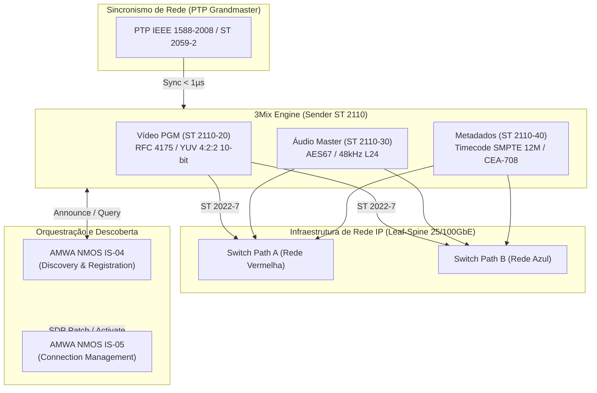
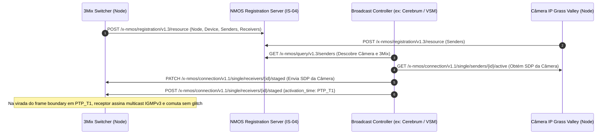

# ARQUITETURA TÉCNICA — SMPTE ST 2110, PTP (ST 2059-2) E AMWA NMOS (IS-04/IS-05)

> **Documento Canônico de Arquitetura de Mídia sobre IP (MoIP) para o 3Mix**  
> Elaborado conforme o mandato da Fase 7 do Superprompt `3Mix_Superprompt_Melhorias_Broadcast_Crew.md`.  
> Classificação: **Estudo Técnico, Especificação de Engenharia e Backlog de Implementação**.  
> **Regra Fundamental**: Nenhuma alteração invasiva no processo produtivo em tempo real sem validação empírica prévia em bancada isolada com hardware compatível.

---

## 1. RESUMO EXECUTIVO E PRINCÍPIOS FUNDAMENTAIS

O padrão **SMPTE ST 2110** (Professional Media Over Managed IP Networks) é o padrão dominante de infraestrutura broadcast profissional para tráfego de sinais não-comprimidos de vídeo, áudio e dados auxiliares em redes IP gerenciadas. 

Diferente dos padrões legados de transporte empacotado como o SMPTE ST 2022-6 (que encapsula o sinal SDI completo com vídeo, áudio e blanking em um único fluxo IP de alta taxa), o ST 2110 adota o princípio de **decomposição de essências (Essence Separation)**:
- O vídeo não comprimido viaja em um fluxo multicast RTP independente.
- Os canais de áudio viajam em fluxos RTP separados (baseados em AES67).
- Os metadados auxiliares (timecode, closed caption, trigger SCTE-104) viajam em um terceiro fluxo RTP independente.

### Vantagens Estratégicas para o 3Mix:
1. **Roteamento de Áudio Sem Desembaralhamento**: O 3Mix pode receber e processar áudio de 64 canais sem precisar receber ou decodificar os 3 Gbps do vídeo correspondente, reduzindo drasticamente o consumo de barramento PCIe e CPU.
2. **Interoperabilidade Broadcast Global**: Conexão nativa com roteadores de vídeo Evertz, Grass Valley, Riedel, Sony e Lawo.
3. **Redundância Seamless Hitless (ST 2022-7)**: Transmissão simultânea por dois caminhos de rede fisicamente distintos (Rede Vermelha e Rede Azul), com comutação no receptor sem perda de um único frame ou pacote de áudio.

---

## 2. DECOMPOSIÇÃO DE ESSÊNCIAS E ESPECIFICAÇÃO DE PROTOCOLOS

### 2.1. SMPTE ST 2110-10: Sincronismo do Sistema e Modelo de Timing
- Define a relação entre o relógio de referência PTP e os relógios de amostragem de mídia RTP.
- O relógio de amostragem de vídeo opera travado em 90 kHz.
- O relógio de áudio opera travado em 48 kHz.
- O campo de timestamp RTP em cada pacote expressa o tempo PTP absoluto (TAI - International Atomic Time) em que o primeiro elemento daquele pacote foi capturado no sensor da câmera.

### 2.2. SMPTE ST 2110-20: Transporte de Vídeo Descomprimido
- Baseado no payload RFC 4175 (RTP Payload Format for Uncompressed Video).
- Apenas a área ativa da imagem (Active Picture) é transmitida; intervalos de blanking vertical e horizontal são omitidos para conservação de banda.
- Espaço de Cor Primário: **YUV 4:2:2 10-bit** (`SMPTE 274M / BT.709` para HD; `BT.2020` para HDR/WCG).

#### Matriz de Throughput de Rede por Fluxo ST 2110-20:
| Formato | Resolução | Taxa de Quadros | Pixel Format | Banda Líquida (Mbps) | Banda de Rede Bruta c/ Header UDP/IP |
|---|---|---|---|---|---|
| **1080i50 / 59.94** | 1920×1080 | 25i / 29.97i | YUV 4:2:2 10-bit | ~830 Mbps | ~1.0 Gbps |
| **1080p50 / 59.94** | 1920×1080 | 50p / 59.94p | YUV 4:2:2 10-bit | ~2.5 Gbps | ~2.8 Gbps |
| **2160p50 / 59.94 (4K UHD)** | 3840×2160 | 50p / 59.94p | YUV 4:2:2 10-bit | ~10.0 Gbps | ~11.2 Gbps |
| **2160p59.94 (4K HDR 4:4:4)** | 3840×2160 | 59.94p | YUV 4:4:4 12-bit | ~18.0 Gbps | ~19.8 Gbps |

### 2.3. SMPTE ST 2110-21: Modelagem de Tráfego e Conformidade de Transmissão (Traffic Shaping)
Como um fluxo de 3 Gbps ou 12 Gbps consiste em dezenas de milhares de pacotes UDP por segundo, a distribuição temporal desses pacotes é crítica para evitar estouro de buffer (overflow) nas portas dos switches de rede:
- **Transmissor Narrow (Tipo N)**: Pacotes espaçados de forma homogênea e contínua ao longo de todo o tempo de varredura do frame (pacing ideal de hardware).
- **Transmissor Narrow Linear (Tipo NL)**: Pacotes espaçados uniformemente apenas durante a linha ativa.
- **Transmissor Wide (Tipo W)**: Tolerante a rajadas típicas de emissão por software (placas de rede padrão em modo kernel).  
*Diretriz para o 3Mix*: No caso de implementar emissão por software puro (Windows/Linux), a conformidade Tipo W é a meta atingível; para Tipo N, exige-se NIC com offload de pacing em hardware (ex: Mellanox ConnectX-6 Dx com Rivermax).

### 2.4. SMPTE ST 2110-30: Áudio PCM Não Comprimido (AES67)
- Amostragem: 48 kHz, quantização de 24 bits linear (L24), Big Endian.
- **Níveis de Conformidade**:
  - **Nível A**: 1 a 8 canais por fluxo, tempo de empacotamento de 1.0 ms (48 amostras por canal por pacote).
  - **Nível B**: 1 a 8 canais, tempo de empacotamento de 125 µs (6 amostras por canal por pacote — ultrabaixa latência).
  - **Nível C**: Até 64 canais por fluxo (tempo de 125 µs).
*Diretriz 3Mix*: Suporte a Nível A para compatibilidade broadcast geral e Nível B para conexões de monitoramento de baixa latência com mesas de corte.

### 2.5. SMPTE ST 2110-40: Metadados Auxiliares (ANC)
- Encapsula pacotes SMPTE ST 291-1 em RTP.
- Permite transporte sincronizado com precisão de frame de:
  - **Timecode SMPTE 12M-2** (ATC / VITC).
  - **Closed Caption / Legendas** (CEA-608 / CEA-708).
  - **Sinalização de Inserção de Comerciais** (SCTE-104 para downstream splice / trigger).

---

## 3. SINCRONISMO E TEMPORIZAÇÃO — IEEE 1588 PTP E SMPTE ST 2059-2

Ao contrário do SDI, que utiliza sinal elétrico de genlock blackburst ou tri-level analógico por cabo coaxial dedicado, o ST 2110 obtém sincronismo temporal estrito através da própria infraestrutura Ethernet utilizando o protocolo **PTPv2 (Precision Time Protocol - IEEE 1588-2008)**.

### 3.1. Perfil SMPTE ST 2059-2
- **Domain padrão**: `127` (específico para instalações broadcast, evitando interferência com domains industriais/financeiros).
- **Taxa de Mensagens**:
  - `Sync`: 8 mensagens por segundo (intervalo de 125 ms, `logSyncInterval = -3`).
  - `Announce`: 4 a 8 mensagens por segundo (`logAnnounceInterval = -2`).
  - `Delay_Req / Delay_Resp`: 8 mensagens por segundo.
- **Requisito de Hardware Obrigatório**: Placa de rede (NIC) com suporte a **Hardware Timestamping** em nível de camada física (PHY/MAC). O timestamping por software no kernel do Windows/Linux introduz jitter de dezenas a centenas de microssegundos devido a interrupções (DPC/ISR), quebrando a conformidade do ST 2110-21. Com hardware timestamping, a precisão alcançada fica abaixo de **100 nanosegundos**.

---

## 4. AMWA NMOS: DESCOBERTA, REGISTRO E CONTROLE DE CONEXÃO

O SMPTE ST 2110 define o plano de dados (Data Plane - RTP/UDP). Ele **não** especifica como os dispositivos se encontram na rede, nem como comutam fontes. Esse papel é desempenhado pelo conjunto de especificações **AMWA NMOS (Networked Media Open Specifications)**, operando via APIs REST JSON sobre HTTP/HTTPS e WebSocket.

### 4.1. AMWA NMOS IS-04: Discovery & Registration
- **Estrutura de Objetos**:
  - `Node`: O servidor físico do 3Mix.
  - `Device`: O motor do 3Mix (ex: switcher principal).
  - `Sources`: Fontes lógicas (ex: PGM, PVW, Clean Feed, AUX 1).
  - `Flows`: Representação do sinal gerado (resolução, taxa, sub-amostragem).
  - `Senders`: Pontos de transmissão multicast IP (com SDP associado).
  - `Receivers`: Pontos de recepção IP (conectáveis às entradas do 3Mix).
- **Descoberta Automática**: Utiliza mDNS (Bonjour / Avahi) ou registros DNS-SD unicast (`_nmos-registration._tcp`) para localizar o NMOS Registry na LAN sem configuração manual de IP.

### 4.2. AMWA NMOS IS-05: Connection Management
- Permite que painéis mestres de roteamento broadcast (Evertz Magnum, Lawo VSM, Ross DashBoard, Grass Valley Cerebrum) conectem saídas de câmeras a entradas do 3Mix com um clique.
- Operação em duas etapas:
  1. **Staged Configuration**: Envio do arquivo SDP do transmissor para a rota `/staged` do receptor.
  2. **Activation**: Disparo da transição imediata ou sincronizada com timestamp PTP exato de fronteira de quadro (`frame boundary activation`).

### 4.3. AMWA BCP-003: Segurança de APIs
- Implementação de TLS (HTTPS) obrigatória em ambientes de missão crítica.
- Autenticação e autorização centralizada via tokens JWT emitidos por servidor OAuth 2.0.

---

## 5. AVALIAÇÃO DE HARDWARE, TOPOLOGIAS E SDKS

### 5.1. Topologia de Rede Recomendada
- **Arquitetura Leaf-Spine Não-Bloqueante**: switches de borda (Leaf) de 25 GbE ou 100 GbE conectados a um core (Spine) com oversubscription 1:1.
- **Controle de Multicast**: Suporte estrito a **IGMPv3 Snooping** e **Querier IGMPv3** ativo em todos os switches.
- **PTP Boundary Clock**: Todos os switches no caminho dos pacotes de mídia devem operar como PTP Boundary Clock (BC) ou Transparent Clock (TC), eliminando o atraso de fila (PDV - Packet Delay Variation).
- **SMPTE ST 2022-7 Dual Path**:
  - Placa de rede de porta dupla (Porta 0 = Rede Primária; Porta 1 = Rede Secundária).
  - Redes fisicamente isoladas com switches independentes e rotas PTP redundantes.

### 5.2. Avaliação Comparativa de SDKs para o 3Mix

| Critério | Intel MCM (Media Communications Mesh) | NVIDIA Rivermax SDK | Linux Kernel / libpcap / Raw Sockets |
|---|---|---|---|
| **Modelo de Licenciamento** | Open Source (Apache 2.0) | Proprietário Comercial (Royalty por porta/nó) | GPL / Open Source |
| **Custo de Distribuição** | **Livre / Gratuito** | Exige licença comercial por licença/máquina | Livre |
| **Mecanismo de Desempenho** | DPDK (Data Plane Development Kit) + Shared Memory | Offload de hardware na NIC Mellanox ConnectX | Kernel Network Stack (Socket UDP padrão) |
| **Pacing de Pacotes** | Software com alta precisão DPDK | **Hardware Pacing direto no silício (ASIC)** | Software puro (Alto Jitter, Tipo W com drops) |
| **Throughput Sustentado** | Excelente para HD e 4K | Excelente para múltiplos fluxos 4K/8K | Inadequado para fluxos não comprimidos (> 1.5 Gbps) |
| **Sistemas Operacionais** | Linux (Ubuntu Server, RHEL); Windows experimental | Windows 10/11 Pro, Linux | Windows / Linux |
| **Recomendação 3Mix** | **Caminho Open-Source Canônico (Core)** | **Opção Enterprise para clientes com NIC Mellanox** | Proibido para uso broadcast ao vivo |

---

## 6. IMPACTO ARQUITETURAL NO ECOSSISTEMA 3MIX

1. **Separação de Processos Críticos**:
   - O tráfego de dados SMPTE ST 2110 (gigabits por segundo) **nunca** deve rodar dentro do processo Node.js (`3mix-panel`), pois o garbage collector do V8 causaria perda de pacotes e latência inaceitável.
   - O ST 2110 deve residir exclusivamente no motor nativo C/C++ (`3mix-engine`) ou em um serviço sidecar nativo de alto desempenho em C++20 (`3mix-io-st2110.exe`), comunicando-se via Shared Memory (SHM) ou ponte interna com zero-copy.
2. **Camada de Orquestração Web (Node.js)**:
   - O `3mix-panel` deve implementar a camada de controle AMWA NMOS (IS-04 e IS-05) via HTTP REST e JSON, aproveitando o ecossistema robusto de rede do Node.js sem tocar nos dados brutos de vídeo.
3. **Isolamento de Falhas Operacionais**:
   - Queda de conexão PTP ou perda de pacotes de um fluxo ST 2110 nunca pode derrubar as saídas locais (HDMI, NDI, SRT ou Gravação ISO).

---

## 7. BACKLOG TÉCNICO E CRITÉRIOS DE ACEITE PARA PROVA DE CONCEITO (PoC)

### Critérios de Entrada para Início da Implementação Prática:
- [ ] Servidor com placa de rede dedicada mínima de **25 GbE** (ex: NVIDIA Mellanox ConnectX-5 ou ConnectX-6 Dx / Intel E810).
- [ ] Switch gerenciado homologado para PTP SMPTE ST 2059-2 e IGMPv3 (ex: Cisco Nexus 9300 ou Arista 7050SX3).
- [ ] Grandmaster Clock PTP físico ou gerador simulado com precisão GPS/GNSS.
- [ ] Aprovação do proprietário do produto para eventual licenciamento de SDKs comerciais (se Rivermax) ou homologação formal de dependência DPDK/MCM.

### Backlog Técnico Estruturado (Milestones Futuras):
1. **Fase 7.1 — Sidecar de Descoberta NMOS IS-04/IS-05 (Node.js)**:
   - Implementação de servidor NMOS Node (`/x-nmos/node/v1.3`).
   - Cliente de registro mDNS e unicast para envio periódico de heartbeats ao NMOS Registry.
   - Interface de gerenciamento de receptores IS-05 para recepção de SDP externo.
2. **Fase 7.2 — Módulo Receptor ST 2110-30 (Áudio AES67)**:
   - Primeiro módulo a testar devido à menor exigência de largura de banda (~1.5 a 12 Mbps por fluxo de áudio).
   - Validação de ingest de áudio PCM 24-bit 48kHz sincronizado via PTP direto no `AudioTapRegistry`.
3. **Fase 7.3 — Ingest de Vídeo ST 2110-20 via DPDK / Intel MCM**:
   - Criação do plugin de vídeo em `3mix-engine/plugins/obs-st2110/`.
   - Conversão do payload RFC 4175 para texturas de frame buffer nativas do OBS com zero-copy.
   - Teste de jitter e C_INST com analisador de conformidade (ex: Bridge Technologies ou Evertz Prism).
4. **Fase 7.4 — Emissão PGM ST 2110-20 e Metadados ST 2110-40**:
   - Saída de Programa e Clean Feed em 1080p59.94 não-comprimido.
   - Inserção de Timecode SMPTE 12M-2 sincronizado ao PTP TAI.

