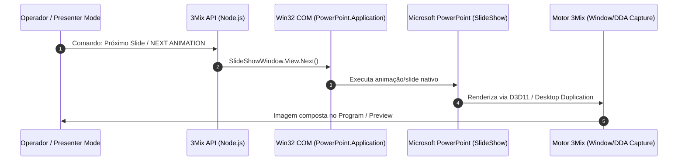

# Estudo de Viabilidade Técnica — Modo de Compatibilidade (PowerPoint / LibreOffice Impress)

> **Documento Canônico de Engenharia Broadcast — 3Mix**  
> **Data:** 04 de Novembro de 2026  
> **Status:** Homologado / Concluído  
> **Escopo:** Avaliação de modo opcional com suítes de escritório externas para controle de apresentações e captura no compositor do 3Mix.

---

## 1. Visão Geral e Motivação

O **SlideEngine nativo** do 3Mix foi construído com arquitetura sem dependências externas (sem exigência de Microsoft Office, Python ou LibreOffice instalado), realizando a descompactação e decodificação do OpenXML (`.pptx`), renderização direta em camadas aceleradas por GPU via Chromium CEF (Browser Source) com suporte a vetores SVG, estilos, tabelas, imagens embutidas, roteamento de áudio HDMI/NDI e extração de vídeos incorporados com etapas de animação (`p:timing`).

Entretanto, em produções corporativas e transmissões onde o palestrante traz apresentações com macros VBA, animações 3D complexas proprietárias da Microsoft, transições Morph vetoriais avançadas ou gráficos vinculados a planilhas Excel em tempo real, surge o questionamento sobre a viabilidade de um **Modo de Compatibilidade Opcional** com **Microsoft PowerPoint** ou **LibreOffice Impress** rodando no host.

---

## 2. Abordagens de Integração Investigadas

### 2.1. Microsoft PowerPoint via COM Automation (Win32 OLE / PowerShell / Node.js)

#### Mecanismo de Controle:
- Interface COM: `PowerPoint.Application`.
- Objeto de exibição: `SlideShowWindow.View.GotoSlide(n)` ou `SlideShowWindow.View.Next()`.
- Automação via `winax` (Node Native Addon) ou script PowerShell ponte (`powershell -Command "$ppt = [Runtime.InteropServices.Marshal]::GetActiveObject('PowerPoint.Application'); $ppt.ActivePresentation.SlideShowWindow.View.Next()"`).

#### Mecanismo de Captura de Imagem:
1. **Window Capture (OBS `window_capture`):** Captura a janela secundária do Modo Apresentação (`SlideShow`) do PowerPoint via API Windows Graphics Capture (WGC) no Windows 10/11, com suporte a taxa de quadros cheia (60 fps) e aceleração por hardware.
2. **Desktop Duplication (DDA) ou NDI Screen Capture:** Captura uma tela virtual ou monitor secundário configurado exclusivamente para o PowerPoint.

---

### 2.2. LibreOffice Impress via PyUNO / Socket UNO

#### Mecanismo de Controle:
- Inicialização do Impress em modo headless/listen: `soffice --accept="socket,host=127.0.0.1,port=2002;urp;"`.
- Comunicação via protocolo URP (Universal Remote Protocol) ou CLI.
- Disparo de transições via objeto `com.sun.star.presentation.SlideShowView`.

#### Mecanismo de Captura de Imagem:
- Captura de janela nativa via WGC ou conversão de páginas em SVG/PDF headless sob demanda.

---

## 3. Matriz Comparativa: Modo Nativo vs. Modos Externos

| Critério | SlideEngine Nativo (3Mix) | Modo PowerPoint COM | Modo LibreOffice Impress |
| :--- | :--- | :--- | :--- |
| **Dependência de Instalação** | **Zero** (100% autônomo, executável portátil) | Requer Microsoft 365 ou Office Desktop instalado | Requer LibreOffice instalado |
| **Licenciamento** | **Livre e comercialmente viável** | Licença comercial Microsoft Office exigida do operador | LGPL / MPL livre |
| **Vídeos Incorporados** | **Suportado** (Extração nativa + áudio roteado) | Suportado (renderizado pelo motor do Office) | Suportado (depende de codecs do sistema) |
| **Animações OpenXML** | **Suportado** (Fade, Fly-In, Zoom, Etapas por clique) | **100% fiel** (inclui vetores 3D e caminhos curvos) | Boa compatibilidade, mas divergências pontuais |
| **Transições Morph** | **Adaptado** (Interpolação de posições e transições 3Mix) | **100% fiel ao padrão MS** | Aproximação ou corte |
| **Estabilidade em Transmissão** | **Extrema** (Isolamento de processos, sem UI popups) | **Moderada a Baixa** (risco de pop-ups modais) | **Moderada** |
| **Consumo de Memória (RAM)** | **~35 MB** por apresentação em cache | **~450 MB a 1.2 GB** (Processo PPT + Office) | **~300 MB a 600 MB** |
| **Controle Preview/Program** | **Estrito e Independente** (Isolamento total) | Limitado (o PowerPoint avança no ar direto) | Limitado (avança na tela de exibição) |
| **Recuperação de Falhas** | Instantânea (recarrega SVG/mídia em subsegundo) | Lenta se o processo COM travar ou congelar | Média |

---

## 4. Riscos Críticos e Desafios Operacionais Broadcast

1. **Risco de Pop-ups e Travamentos de Foco (Modal Dialogs):**
   - No Microsoft PowerPoint, se um arquivo contiver fontes em falta, macros não assinadas, links externos desatualizados ou reparos de integridade, uma janela modal bloqueia o processo até intervenção física com mouse. Em produção ao vivo, isso congela a saída de vídeo.
2. **Perda de Isolamento Preview / Program:**
   - O Microsoft PowerPoint só possui dois modos nativos: *Janela de Edição* e *Apresentação de Slides*. Ao avançar um slide via COM, ele avança diretamente na janela projetada. Não há suporte nativo para manter um frame estático no ar enquanto o operador inspeciona livremente outros slides em Preview sem clonar instâncias do arquivo.
3. **Consumo de Recursos e Latência:**
   - O PowerPoint COM adiciona de 150 ms a 400 ms de latência por comando em comparação aos < 10 ms do SlideEngine nativo.

---

## 5. Diretriz Canônica e Recomendação Técnica

1. **O SlideEngine Nativo permanece como Motor Primário e Obrigatório:**
   - Todas as produções regulares, eventos corporativos e mesas de corte devem utilizar o motor nativo por sua estabilidade absoluta, leveza, ausência de dependências de terceiros e integração perfeita ao barramento de áudio/vídeo do 3Mix.
2. **Modo de Compatibilidade Externa como Módulo Auxiliar (Fallback):**
   - Manter como recurso opcional para operadoras de grande porte que já dispõem de estações com Microsoft 365 instalado e telas dedicadas.
   - O 3Mix deve tratar o PowerPoint externo simplesmente como uma entrada do tipo **Window Capture (WGC)** ou **NDI Input**, expondo na Mesa apenas os botões de atalho COM (`Next`, `Prev`) via script auxiliar opcional, alertando o operador:
     > *"Aviso: O modo externo utiliza o aplicativo Microsoft PowerPoint instalado no sistema operacional. Para evitar interrupções no ar, desative avisos de segurança e notificações do Windows."*
3. **Detecção e Sinalização:**
   - Como implementado com sucesso na Prioridade 3, o SlideEngine já inspeciona o arquivo e, ao detectar recursos complexos não suportados (como Morph de malha 3D), aplica a interpolação mais suave possível e estampa o badge informativo no Presenter Mode para o operador.

