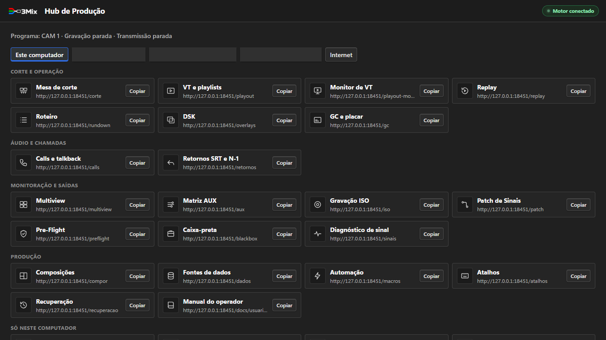
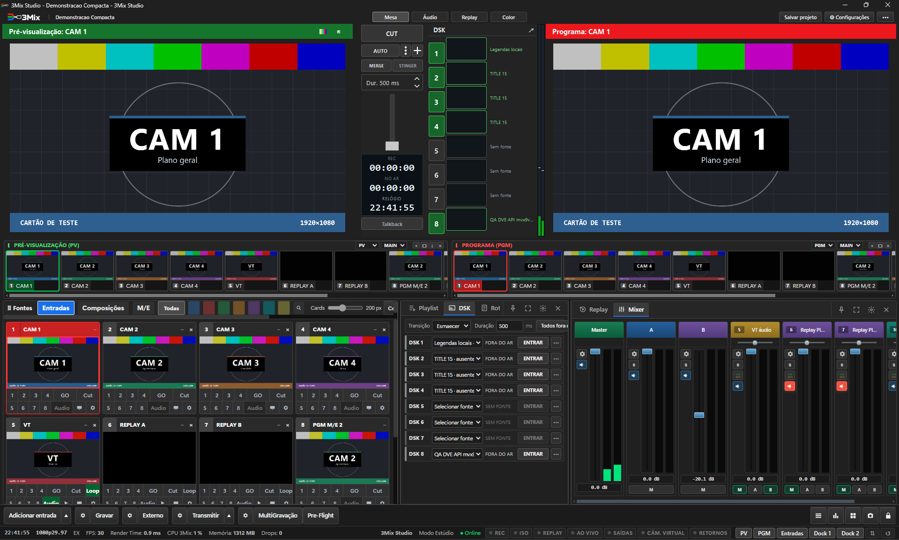
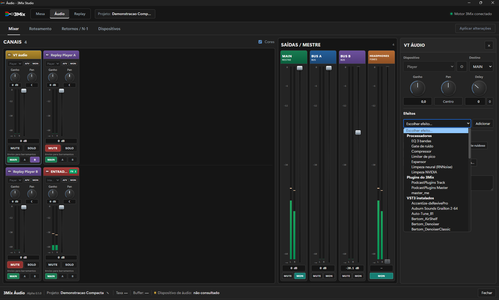
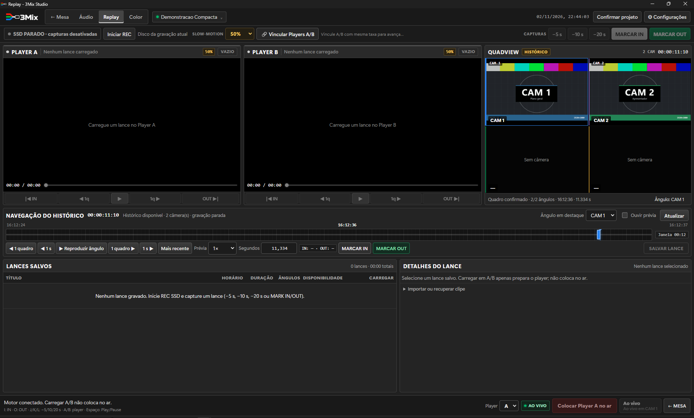
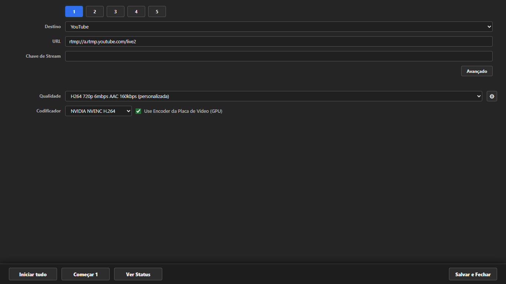
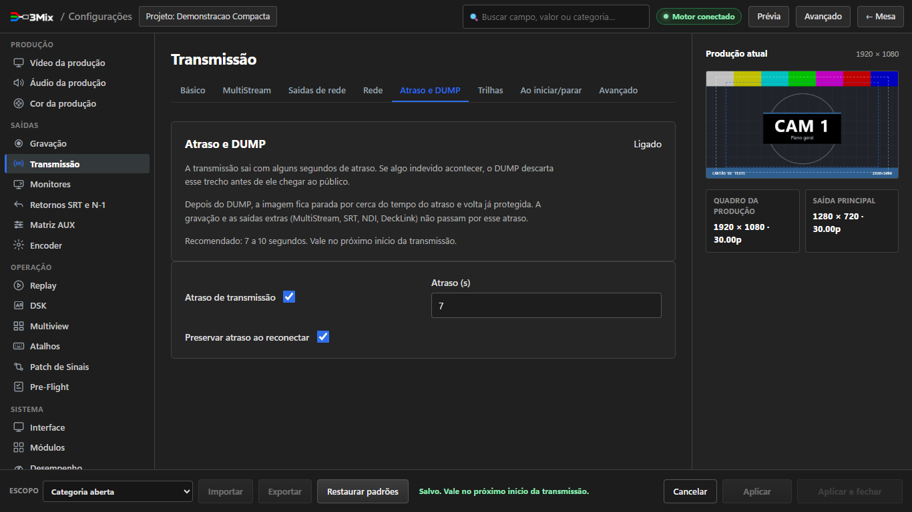
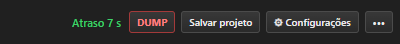
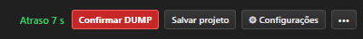
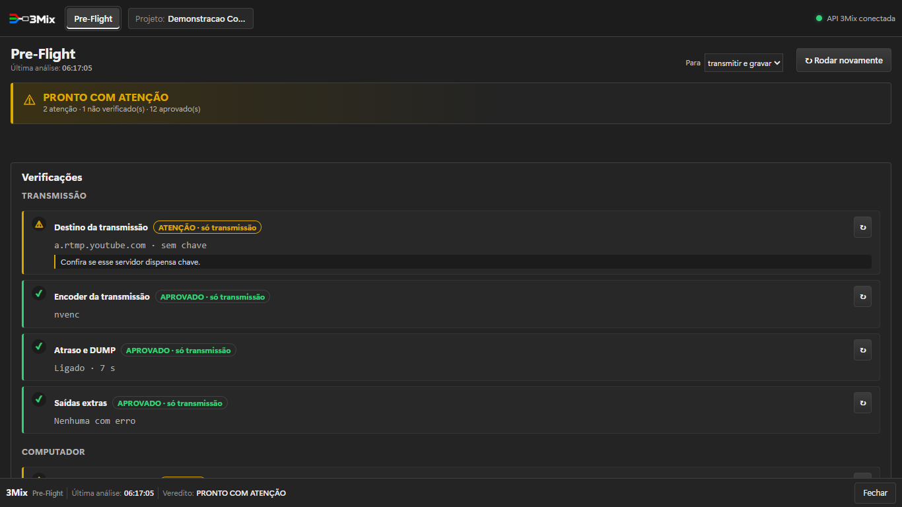

# 3Mix — Guia Rápido (Alpha)

Do primeiro clique ao primeiro corte no ar, em uma página. As imagens são telas reais do 3Mix. O passo a passo completo de cada tela está no **Manual do Operador** (Hub › Manual do operador, ou `painel/docs/usuario/manual-operador.html`). Para saber qual documento ler, veja [`MANUAIS.md`](MANUAIS.md).

---

## 1. Instalar

- **ZIP da Alpha:** extraia o ZIP inteiro numa pasta sua (por exemplo `Documentos\3Mix`). Não abra de dentro do ZIP.
- **Instalador (.exe):** escolha uma pasta nova e vazia.

Confira o SHA-256 antes (seção 8 de [`LEIA-ME-BETA.md`](LEIA-ME-BETA.md)). Se o Windows mostrar "O Windows protegeu o computador", veja a seção 6 do mesmo arquivo.

## 2. Abrir

Dê dois cliques em **3Mix Studio.cmd** (ou no atalho **3Mix Studio**). Não abra o executável do motor sozinho. Espere o selo **Motor conectado**.

## 3. Hub de Produção

Ponto de partida das telas de operação. Cada cartão abre um módulo; **Copiar** copia o endereço para usar em outro computador ou tablet.

## 4. Mesa principal

Pré-visualização (verde) e Programa (vermelho) no alto; CUT, AUTO, T-Bar e DSK no meio; entradas embaixo; mixer ao lado; rodapé com **Adicionar entrada**, **Gravar**, **Externo**, **Transmitir** e **Pre-Flight**.

1. **Adicionar entrada** e escolha o tipo (câmera, mídia, GC, call…).
2. Clique no cartão da entrada: ela vai para o Preview.
3. **CUT** (seco) ou **AUTO** (com a transição e a duração escolhidas). No cartão, **GO** leva ao ar com a transição e **Cut** corta seco.
4. Os botões **1** a **8** do cartão operam os DSK: primeiro clique prepara, segundo entra no ar.

## 5. Áudio

Aba **Áudio** da barra superior: canais com Ganho, Pan, MUTE, SOLO, AFV e MON; envios MAIN, A e B; saídas MAIN (vai ao ar), BUS A, BUS B e fones; efeitos e plugins no inspetor do canal.

## 6. Replay

**Iniciar REC** guarda o histórico das câmeras. **−5 s / −10 s / −20 s** ou **MARCAR IN / OUT** salvam o lance; carregue em A ou B e use **Colocar Player A no ar**. Carregar em A/B não coloca no ar sozinho.

## 7. Gravar e transmitir

- **⚙ ao lado de Gravar:** formato, pasta e qualidade. **Gravar** inicia e para.
- **⚙ ao lado de Transmitir:** destino, URL e chave. **Transmitir** inicia e para.

## 8. Atraso e DUMP

Proteção para a transmissão principal: ela sai alguns segundos atrasada e o **DUMP** descarta o trecho que ainda não foi ao ar.

1. **Configurações › Transmissão › Atraso e DUMP**: marque **Atraso de transmissão**, escolha **7 a 10 s**, deixe **Preservar atraso ao reconectar** e **Aplicar**.
2. Vale no próximo início da transmissão.
3. No ar, a barra mostra **Atraso 7 s** em verde. Para descartar: clique **DUMP**, depois **Confirmar DUMP** em até 3 s.

 

O DUMP cobre só a transmissão principal: gravação e saídas extras (MultiStream, SRT, NDI, DeckLink) não passam pelo atraso. Depois do DUMP, o destino fica com a imagem parada por cerca do tempo do atraso.

## 9. Antes de ir ao ar

1. Clique em **Pre-Flight**, escolha **Para: transmitir e gravar / só transmitir / só gravar** e resolva o que estiver em **BLOQUEIO** ou **ATENÇÃO**. O **↻** de cada item confere só aquele item de novo.
2. Feche ou ignore os **Programas concorrentes** apontados.
3. Faça uma gravação curta de teste e abra o arquivo.

## 10. Se algo der errado

- **Caixa-preta › Registrar incidente agora** guarda os últimos 60 segundos.
- **Configurações › Sobre e suporte › Relatar problema › Gerar pacote** cria o ZIP para o suporte. Se o 3Mix nem abrir, use **COLETAR-LOGS.cmd**.
- Veja [`SOLICITAR-SUPORTE.md`](SOLICITAR-SUPORTE.md) e confira em [`LIMITES-CONHECIDOS.md`](LIMITES-CONHECIDOS.md) se o comportamento já é um limite conhecido desta Alpha.
