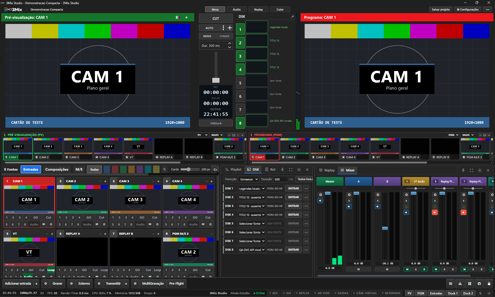

# 3Mix — Leia-me da Alpha

O que é o 3Mix, como instalar, abrir, criar o primeiro projeto, atualizar e desinstalar, e o que esta Alpha ainda não garante.

- Passo a passo ilustrado: [`GUIA-RAPIDO.md`](GUIA-RAPIDO.md).
- Manual completo de operação: **Manual do Operador** (Hub › Manual do operador, ou `painel/docs/usuario/manual-operador.html`).
- Qual documento é para quem: [`MANUAIS.md`](MANUAIS.md).
- O que ainda não foi provado: [`LIMITES-CONHECIDOS.md`](LIMITES-CONHECIDOS.md).
- Relatar problema: [`SOLICITAR-SUPORTE.md`](SOLICITAR-SUPORTE.md).
- Termos de uso: [`EULA.txt`](EULA.txt); componentes de terceiros e oferta de código-fonte GPL: [`THIRD-PARTY-NOTICES.txt`](THIRD-PARTY-NOTICES.txt).

---

## 1. O que é o 3Mix

Suíte de produção e transmissão ao vivo: mesa de corte com Preview e Programa, transições, DSK, M/E extras, mixer de áudio com barramentos e plugins, replay multicâmera, GC, gravação, transmissão (RTMP/SRT), saídas NDI/OMT/SRT, Pre-Flight, caixa-preta e Atraso com DUMP. Tudo em interface própria sobre um motor nativo derivado do OBS Studio.

A unidade de trabalho é a **entrada** (câmera, VT, GC, call, replay, composição), e não cenas e fontes soltas. Visão de produto: [`PRODUCT-VISION.md`](PRODUCT-VISION.md).

Esta é uma **Alpha** (0.1.x): funciona e foi testada no computador de desenvolvimento, mas Windows "limpo", placas de captura, ASIO físico e calls pela internet ainda não foram comprovados fora dele (seção 7).



---

## 2. Antes de instalar

- Windows 10/11 de 64 bits.
- Cerca de 2,5 GB livres para a instalação (o ZIP da Alpha tem 1,36 GB e o instalador 1,6 GB), mais o espaço das gravações.
- Uma pasta **nova e vazia**.
- Não precisa de Node.js, Visual Studio ou outras ferramentas: o pacote traz o que usa (Node, FFmpeg).

---

## 3. Como instalar

**Pelo ZIP (forma usada para testes da Alpha):**

1. Confira o SHA-256 do ZIP (seção 8).
2. Extraia o ZIP **inteiro** numa pasta sua, por exemplo `Documentos\3Mix`. Não abra de dentro do ZIP.
3. Dê dois cliques em **3Mix Studio.cmd**.

**Pelo instalador (.exe):**

1. Confira o SHA-256 do instalador (seção 8).
2. Dê dois cliques. Se o Windows avisar, veja a seção 6.
3. Escolha uma pasta **nova e vazia** e aguarde a cópia.
4. Use o atalho criado. Não execute o motor (`bin\64bit\`) diretamente.

A instalação começa com um projeto vazio. Importar um projeto existente é opcional e separado. Reinstalar ou atualizar preserva projetos, mídia, gravações, diagnósticos e arquivos que você modificou.

---

## 4. Como abrir e fechar

- Abrir: **3Mix Studio.cmd** (ou o atalho **3Mix Studio**). No computador de desenvolvimento: `INICIAR-3MIX.cmd`.
- O iniciador sobe o motor e o painel e só termina quando os dois respondem.
- Reiniciar: `REINICIAR-3MIX.cmd`. Fechar liberando as portas: `DESLIGAR-3MIX.cmd`.
- Salve antes de fechar: **Salvar projeto** na barra superior da mesa.

---

## 5. Primeiro projeto

1. Abra pelo iniciador. A mesa abre com uma produção vazia.
2. **Adicionar entrada** (rodapé da mesa) e escolha o tipo: câmera, mídia, GC, call…
3. Clique na entrada para pô-la no **Preview**; **CUT** ou **AUTO** leva ao **Programa**, que é o que vai ao ar.
4. Explore a barra superior (**Áudio**, **Replay**, **Color**) e o **Hub de Produção** para os demais módulos.
5. Antes de transmitir: configure o destino (⚙ ao lado de **Transmitir**), ligue o **Atraso e DUMP** se quiser essa proteção e rode o **Pre-Flight**.

Passo a passo com imagens: [`GUIA-RAPIDO.md`](GUIA-RAPIDO.md).

---

## 6. Se o Windows avisar ("O Windows protegeu o computador")

Esta Alpha **não tem assinatura Authenticode** (certificado de editor reconhecido pela Microsoft). O pacote tem uma assinatura interna própria de integridade, que o Windows não reconhece como editor verificado.

1. **Confira o SHA-256 primeiro** (seção 8).
2. Na tela azul, clique em **Mais informações**.
3. Confira o nome do arquivo e clique em **Executar assim mesmo**.

Se o hash não bater, **não execute**.

---

## 7. Limites desta Alpha (resumo)

Esta Alpha **não promete** (detalhes e fontes em [`LIMITES-CONHECIDOS.md`](LIMITES-CONHECIDOS.md)):

- Instalação comprovada em Windows "limpo".
- Calls com convidados reais pela internet.
- SDI/DeckLink, ASIO físico, HDR fim a fim e PTZ com hardware real.
- NDI Advanced e bonding multipath em redes reais.
- Importar projetos de outros programas.
- Várias horas seguidas no ar medidas e aprovadas.
- **DUMP** só na transmissão principal: gravação e saídas extras não passam pelo atraso; depois do DUMP o destino fica parado por cerca do tempo do atraso; mudar o atraso exige reiniciar a transmissão.

---

## 8. Conferência de integridade (SHA-256)

Pacotes Alpha registrados em `entregas/` (hashes recalculados em 03/11/2026 e iguais aos registros de montagem):

```text
Arquivo:  3Mix-Alpha-20261103011403.zip
Tamanho:  1.359.892.459 bytes
SHA-256:  1a57f329f19306db9e5d6693af9ffd051de3b0c14291bbe968816cbe4ed10ec1

Arquivo:  3Mix-Setup-20261103011403.exe
Tamanho:  1.603.612.783 bytes
SHA-256:  41d53a8971cbc31fe307b9aed17118a60137589b74e8f2e7e6330c56965d5141
```

> Estes dois pacotes foram montados antes do botão DUMP na barra da mesa (Alpha 0.1.1). Quem precisa do Atraso e DUMP deve receber um pacote mais novo; a versão instalada aparece em **Configurações › Sobre e suporte**.

Para conferir no Windows, no PowerShell, na pasta do arquivo:

```powershell
Get-FileHash .\3Mix-Alpha-20261103011403.zip -Algorithm SHA256
```

Compare com o valor acima. Se não bater, não instale.

---

## 9. Como atualizar

- **Configurações › Sobre e suporte › Atualizações**: **Procurar atualização** e **Atualizar agora**. Na barra da mesa aparece **Nova versão** quando há uma pronta.
- Na pasta instalada também há **Atualizar 3Mix.cmd**.
- A atualização só é aplicada com o 3Mix fechado normalmente; ela não encerra a produção à força e guarda cópia da versão anterior.

---

## 10. Como desinstalar

Use o desinstalador incluído na pasta instalada. Ele:

- remove só os arquivos da instalação que continuam iguais (tamanho e SHA-256) ao que foi instalado;
- **preserva** projetos, mídia, gravações, diagnósticos, logs e arquivos modificados;
- não apaga a pasta inteira;
- recusa rodar com o 3Mix aberto e não encerra processos.

---

## 11. Documentos relacionados

- [`MANUAIS.md`](MANUAIS.md) — índice dos manuais.
- [`GUIA-RAPIDO.md`](GUIA-RAPIDO.md) — uma página com imagens.
- [`LIMITES-CONHECIDOS.md`](LIMITES-CONHECIDOS.md) — o que não funciona ou não foi provado, com fontes.
- [`SOLICITAR-SUPORTE.md`](SOLICITAR-SUPORTE.md) — como gerar o pacote de diagnóstico.
- [`CHANGELOG.md`](CHANGELOG.md) — novidades de cada versão.


## Gate de distribuição e homologação vMix 30

As missões 7–11 de PEDIDO-COMUNIDADE-ALPHA.md exigem confirmação da capacidade no pacote instalado. Não anunciar 10 bits, 16 canais, modelos AJA ou MKV NDI com metadados por existência de opção genérica. Código/compilação/mock e teste físico são estados distintos. Sem evidência de ensaio por modelo, driver e modo, não marcar Homologado.

Inclusão de alterações desta auditoria no instalador/runtime ainda não verificada: nenhum pacote novo está sendo declarado distribuído por esta nota. Antes de enviar: versão/hash, dependências e licenças, manifesto de arquivos, compatibilidade de projetos, backup/rollback e coleta de logs sanitizados. Replay de 16 câmeras e 3Mix IO ficam fora do escopo.
