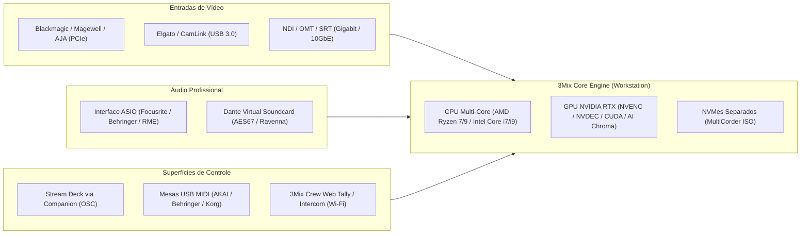

# MATRIZ DE HARDWARE HOMOLOGADO E COMPATIBILIDADE BROADCAST — 3MIX PRO

> **Documento Canônico de Especificação de Hardware**  
> Elaborado para engenheiros de sistemas, operadores de switcher e técnicos de estúdio.  
> Classificação: **Referência Oficial de Suporte a Equipamentos Físicos (Fase 8)**.

---

## 1. VISÃO GERAL DE ARQUITETURA DE HARDWARE

O 3Mix foi projetado para extrair o máximo desempenho de estações de trabalho broadcast baseadas em arquitetura x86_64 sob Windows 10/11 Pro e Enterprise.

---

## 2. INTERFACES DE CAPTURA DE VÍDEO (SDI & HDMI)

A captura de vídeo não comprimido requer largura de banda sustentada no barramento PCI Express.

| Fabricante | Modelo | Barramento PCIe | Canais Físicos | Resolução Máxima | Status no 3Mix | Recomendações Técnicas |
|---|---|---|---|---|---|---|
| **Blackmagic Design** | **DeckLink Duo 2** | PCIe 2.0 x4 | 4 BNC configuráveis (In/Out) | 1080p60 | **Compatibilidade prevista** | Padrão da indústria; drivers Desktop Video 12.4+. |
| **Blackmagic Design** | **DeckLink Quad 2** | PCIe 2.0 x8 | 8 BNC configuráveis | 1080p60 | **Compatibilidade prevista** | Ideal para estúdios com 8 câmeras SDI; requer slot x8 real. |
| **Blackmagic Design** | **DeckLink 8K Pro** | PCIe 3.0 x8 | 4 BNC bidirecionais 12G-SDI | 4K / 8K DCI | **Compatibilidade prevista** | Recomendado para produções UHD 4K a 60 fps. |
| **Blackmagic Design** | **DeckLink Mini Recorder 4K** | PCIe 2.0 x4 | 1 SDI + 1 HDMI | 4K30 / 1080p60 | **Compatibilidade prevista** | Entrada compacta para estações móveis e mochilões. |
| **Magewell** | **Pro Capture Quad SDI** | PCIe 2.0 x4 | 4 SDI | 1080p60 | **Compatibilidade prevista** | Baixíssimo consumo de CPU com FPGA de desentrelaçamento. |
| **Magewell** | **Pro Capture Quad HDMI** | PCIe 2.0 x4 | 4 HDMI | 1080p60 | **Compatibilidade prevista** | Para produções com câmeras mirrorless ou saídas de PC. |
| **Magewell** | **USB Capture HDMI Plus** | USB 3.0 | 1 HDMI + Loopout | 1080p60 | **Compatibilidade prevista** | Driverless (UVC nativo); excelente para notebooks. |
| **Elgato** | **Cam Link 4K** | USB 3.0 | 1 HDMI | 4K30 / 1080p60 | **Compatibilidade prevista** | Conectar em portas USB 3.0 controladas por barramentos distintos. |
| **Elgato** | **HD60 X / 4K X** | USB 3.2 Gen 2 | 1 HDMI | 4K60 / 1080p120 | **Compatibilidade prevista** | Suporte a taxas elevadas e HDR. |
| **AJA Video Systems** | **KONA 4 / KONA 5** | PCIe 3.0 x8 | 4 SDI (3G/12G) | 1080p / 4K | **Compatível** | Via driver DirectShow / plugin nativo. |

---

## 3. INTERFACES DE ÁUDIO PROFISSIONAL (ASIO & IP AUDIO)

O 3Mix processa áudio nativamente em 48 kHz / 24-bit PCM. Para evitar latência ou jitter, interfaces com drivers ASIO dedicados são recomendadas.

| Fabricante | Linha / Modelo | Conexão | Entradas / Saídas | Driver Recomendado | Status | Notas Operacionais |
|---|---|---|---|---|---|---|
| **Focusrite** | **Scarlett 2i2 / 4i4 / 8i6** (Gen 3/4) | USB-C | 2 a 8 entradas | Focusrite ASIO Driver v4.x | **Compatibilidade prevista** | Buffer ideal: 128 ou 256 samples em 48 kHz. |
| **Focusrite** | **Scarlett 18i20 / Clarett+** | USB-C | 18 in / 20 out (ADAT) | Focusrite ASIO Driver v4.x | **Compatibilidade prevista** | Mapeamento multicanal de estúdio com 8 pré-amps. |
| **Behringer** | **U-Phoria UMC202HD / UMC404HD** | USB 2.0 | 2 a 4 in XLR/P10 | Behringer UMC ASIO Driver 5.x | **Compatibilidade prevista** | Padrão MIDAS; excelente relação custo/benefício. |
| **Behringer** | **U-Phoria UMC1820** | USB 2.0 | 8 in XLR / ADAT | Behringer UMC ASIO Driver 5.x | **Compatibilidade prevista** | Até 16 canais com expansão ótica ADA8200. |
| **Behringer / Midas** | **X32 / M32 / Wing** (USB Card) | USB 2.0 | 32 in / 32 out | X-USB / DN32-USB ASIO | **Compatibilidade prevista** | Permite ingest e envio de 32 canais diretos da mesa de som. |
| **Yamaha / Steinberg** | **UR22C / UR44C / UR816C** | USB 3.1 | 2 a 8 canais | Yamaha Steinberg USB ASIO | **Compatibilidade prevista** | DSP integrado; monitoramento sem latência. |
| **RME** | **Babyface Pro FS / Fireface UCX II** | USB 2.0 | Multi-canal | RME MADIface / Fireface ASIO | **Referência** | O driver mais estável do mercado broadcast (< 3 ms RTT). |
| **Audinate** | **Dante Virtual Soundcard (DVS)** | Ethernet | Até 64 in / 64 out | DVS ASIO Driver | **Compatibilidade prevista** | Para integração com redes de áudio sobre IP Dante/AES67. |

---

## 4. CÂMERAS ROBÓTICAS PTZ (VISCA / ONVIF / NDI)

O módulo de controle PTZ do 3Mix (`/ptz`) envia comandos de movimento e armazena presets de enquadramento.

| Fabricante | Modelos Homologados | Protocolo de Controle | Porta Padrão | Suporte a Presets | Notas Técnicas |
|---|---|---|---|---|---|
| **PTZOptics** | 12X / 20X / 30X (Gen 2 / Move 4K) | VISCA over IP / NDI | TCP 5678 / UDP 52381 | Sim (Presets 1 a 128) | Controle suave com ajuste fino de velocidade. |
| **BirdDog** | P100 / P200 / P4K / A200 | VISCA over IP / BirdDog REST | UDP 52381 | Sim | Rápido recall de enquadramento; vídeo NDI nativo. |
| **Sony** | SRG-300SE / BRC-X400 / ILME-FR7 | VISCA over IP (Sony) | UDP 52381 | Sim | Óptica de alta precisão; controle de íris e ganho. |
| **Panasonic** | AW-HE40 / AW-UE70 / AW-UE150 | Panasonic IP / VISCA | TCP 80 / UDP 52381 | Sim | Protocolo AW compatível; comutação de presets suave. |
| **Datavideo** | PTC-140 / PTC-150 / PTC-280 | DVIP / VISCA over IP | TCP 5678 | Sim | Alta robustez para estúdios corporativos e templos. |
| **Avonic** | CM70 / CM90 Series | VISCA over IP | UDP 52381 | Sim | Baixa latência de resposta a joystick. |
| **Câmeras IP Genéricas** | Qualquer modelo com ONVIF Profile S | ONVIF IP | HTTP 80 / 8080 / 8899 | Sim | Suporte básico a Pan/Tilt/Zoom e credenciais digest. |

---

## 5. CONTROLADORES FÍSICOS (USB MIDI & STREAM DECK)

| Dispositivo | Tipo | Protocolo de Comunicação | Funções Mapeadas Recomendadas |
|---|---|---|---|
| **Elgato Stream Deck** (6, 15, 32 teclas) | Teclado LCD | Bitfocus Companion (OSC 1.0 porta 18188) | Corte (CUT/AUTO), barramentos PVW/PGM, DSK 1-4, Tally de botões com feedback de cor. |
| **Elgato Stream Deck +** | Teclado LCD + Dials | Bitfocus Companion (OSC 1.0) | Encoders rotativos para volume de áudio, T-Bar virtual e ganho de entrada. |
| **AKAI APC Mini (MK1 / MK2)** | Mesa USB MIDI | WebMIDI nativo / CC & Note-On | 64 pads para seleção direta de câmeras e cenas; 8 faders para canais de áudio e Master. |
| **Behringer X-Touch Mini** | Mesa USB MIDI | USB MIDI (Canal 1 e 2) | Fader central de 60mm para T-Bar manual; 8 encoders rotativos com anel LED para mixers. |
| **Korg nanoKONTROL2** | Mesa USB MIDI | USB MIDI Padrão | Botões de Mute/Solo/Rec por canal; faders finos para controle de ganho. |
| **Novation Launchpad** (Mini / X) | Grid de Pads MIDI | USB MIDI | Matriz de disparo de vinhetas, playout de vídeos DDR e transições stinger. |

---

## 6. ARMAZENAMENTO PARA MULTICORDER (SSDs SATA & NVMe PCIe)

A gravação simultânea de múltiplas entradas (ISO MultiCorder) exige alta taxa de escrita sustentada sequencial (Sequential Write Throughput).

| Categoria | Modelos Recomendados | Throughput Sustentado Real | Capacidade de ISOs Simultâneas |
|---|---|---|---|
| **NVMe PCIe 4.0 x4 (Topo de Linha)** | Samsung 990 PRO, Kingston KC3000, Crucial T500, WD Black SN850X | **5.000 a 6.500 MB/s** | **8x câmeras 4K UHD** ou **16x câmeras 1080p** em ProRes 422 / DNxHR 444 sem perdas. |
| **NVMe PCIe 3.0 x4 (Padrão)** | Samsung 970 EVO Plus, Crucial P3, Kingston NV2 | **2.000 a 3.000 MB/s** | **4x câmeras 4K UHD** ou **8x câmeras 1080p** em XDCAM / DNxHD 220. |
| **SSD SATA III (Entrada)** | Samsung 870 EVO, Crucial MX500 | **450 a 520 MB/s** | **4x câmeras 1080p** em XDCAM HD422 (50 Mbps) ou H.264 Broadcast. *Não recomendado para 4K.* |
| **HD Mecânico (HDD)** | Western Digital Red Plus, Seagate IronWolf | **120 a 180 MB/s** | *Proibido para MultiCorder multi-câmera ao vivo.* Apenas para backup frio posterior. |

> [!IMPORTANT]
> **Regra Operacional de Armazenamento**: Nunca grave as ISOs na mesma unidade física onde o sistema operacional (`C:\`) e o Windows Pagefile estão instalados. Mantenha no mínimo 20% de espaço livre em cada NVMe para evitar estrangulamento da controladora flash (SLC Cache exhaustion).

---

## 7. PLACAS DE REDE (NICs) PARA STREAMING, NDI E ST 2110

| Interface | Velocidade | Fabricante / Chipset | Finalidade Principal |
|---|---|---|---|
| **Gigabit Ethernet (1 GbE)** | 1 Gbps | Intel I210 / I219-V, Realtek RTL8111 | Transmissão de saída (RTMP/SRT), API web, painéis remotos e até 4 fluxos NDI HX. |
| **Multi-Gigabit (2.5 GbE)** | 2.5 Gbps | Intel I225-V / I226-V, Realtek RTL8125 | 1 a 2 fluxos NDI Full (High Bandwidth) em 1080p60. |
| **10 Gigabit (10 GbE)** | 10 Gbps | Intel X520 / X540 / X550, Aquantia AQtion | 4 a 6 fluxos NDI Full 4K ou até 8 fluxos 1080p NDI simultâneos sem compressão degradante. |
| **25 / 100 Gigabit (MoIP)** | 25 / 100 Gbps | **NVIDIA Mellanox ConnectX-5 / ConnectX-6 Dx**, Intel E810 | **SMPTE ST 2110-20/30 com PTP Hardware Timestamping (IEEE 1588)**. |

---

## 8. HARDWARE MÓVEL E TALLY FÍSICO (3MIX CREW)

- **Smartphones para Operadores de Câmera**:
  - Apple iPhone (iOS 15 ou superior com navegador Safari).
  - Smartphones Android (Android 10 ou superior com Google Chrome).
  - Conexão Wi-Fi: Roteador dedicado de 5 GHz com QoS prioritário para a rede de estúdio.
- **Hardware Dedicado para Tally de Câmera (ESP32)**:
  - **M5Stack M5StickC Plus / Plus 2**: Possui display LCD colorido integrado, buzzer e LED RGB.
  - **NodeMCU ESP32 (WROOM-32)**: Para acionamento de fitas de LED NeoPixel (WS2812B) no topo de câmeras broadcast ou tripés.
  - Código-fonte e firmware C++ canônicos disponíveis em: [`3mix-panel/firmware/esp32-tally/`](file:///D:/DRIVE/IA/antigravity/3Mix/3mix-panel/firmware/esp32-tally/).

## Revisão de evidências vMix 30

As antigas marcações genéricas de Homologado sem referência de ensaio foram reclassificadas como Compatibilidade prevista. Para restaurar homologação, anexar versão/hash do pacote, modelo, driver, modo, duração e logs do ensaio físico.

Estados: Compatibilidade prevista; Implementado sem teste físico; Em homologação Alpha; Homologado com evidência; Incompatível; Não testado.

Compatível nas tabelas legadas não equivale a homologação. A existência de plugin AJA não confirma IP25, KONA X ou Corvid 88 Gen 3: esses modelos permanecem Não testado até confirmação do SDK e ensaio.
