# 3MIX PRO — CHAMADO À COMUNIDADE DE TESTERS ALPHA

> **Versão:** 3Mix Alpha Pro (Gratuita e Aberta para Operadores e Engenheiros Broadcast)  
> **Missão:** Validar estabilidade de transmissão, compatibilidade de hardware físico e ergonomia operacional ao vivo.

---

## 1. MENSAGEM DA ENGENHARIA 3MIX

Operadores, diretores de TV, técnicos de streaming e engenheiros de transmissão:

O **3Mix** foi concebido desde a primeira linha de código para ser uma suíte broadcast de produção ao vivo profissional, modular com foco em confiabilidade operacional. Ele não é uma skin de OBS nem um clone jurássico do vMix — sua interface unificada no padrão **grafite MotionCaster** foi desenhada para operações de missão crítica.

Há testes automatizados e ensaios locais de partes do áudio, vídeo, roteamento e interface. Cada resultado vale somente para o build, cenário e duração registrados; não comprova estabilidade universal nem segurança integral. Crashes nativos ainda sem causa e correção comprovadas impedem declarar o RC concluído.

Porém, software de transmissão de alta fidelidade depende da interação com o mundo físico: cabos, placas de rede de alta velocidade, consoles de áudio, câmeras com motores mecânicos, placas de captura SDI/HDMI e GPUs de diferentes fabricantes. **É aqui que a comunidade entra.**

Nesta fase Alpha, o software é **100% gratuito e liberado** para que vocês estressem todas as engrenagens em estúdios, igrejas, arenas, emissoras e produtoras.

---

## 2. IDENTIDADE DO BUILD E ESTADO DE VALIDAÇÃO

Esta convocação não é inventário da instalação do operador nem certificado de homologação. A versão exata de cada componente deve vir do recibo do pacote entregue e da inspeção daquela instalação. Não reutilize números de uma Alpha anterior.

| Componente / capacidade | Evidência necessária | Estado sem recibo da release exata |
|---|---|---|
| Motor OBS33 / 3Mix | Commit e overlays, hash do EXE e obs.dll, build e abertura isolada | NÃO HOMOLOGADO |
| Transporte SRT | Versão/hash da DLL efetivamente carregada, envio/recepção e reconexão | NÃO TESTADO no equipamento/rede |
| Chromium / CEF | Versão/hash carregados, transparência, áudio e estabilidade de fontes web | NÃO HOMOLOGADO |
| FFmpeg integrado e CLI | Versões/hashes separados, codecs e arquivos reproduzidos/analisados | NÃO HOMOLOGADO |
| NDI / DistroAV e OMT | Versão/hash do plugin e SDK carregados, teste entre máquinas e sincronismo | NÃO TESTADO sem bancada correspondente |
| Gerenciador de plugins | ZIP/layout, proteção de módulos do sistema, aplicação na próxima abertura e recuperação | Testes automatizados não substituem ensaio nativo |
| PTZ, ASIO, DeckLink e AJA | Modelo, firmware/driver, sinal e mapa de canais reais | NÃO TESTADO sem hardware |

Pacotes oficiais de Shaderfilter, Advanced Masks e Color Monitor têm inspeção de layout e recursos separada da execução nativa. Carregamento, renderização e estabilidade só podem ser marcados PASSOU com recibo específico. Não há alegação de correção de CVE neste guia: qualquer aviso de segurança exige referência oficial e identificação do binário distribuído.

---

## 3. O QUE JÁ ESTÁ PRONTO E O QUE DEPENDE DE TESTE FÍSICO (ALPHA TESTERS)

Pedimos que os testers da comunidade escolham uma ou mais missões abaixo, de acordo com o equipamento disponível no seu estúdio:

```mermaid
flowchart TD
    M1["Missão 1: Interfaces ASIO<br/>(Focusrite, Behringer, Yamaha, RME)"]
    M2["Missão 2: Câmeras PTZ<br/>(VISCA IP / ONVIF)"]
    M3["Missão 3: Controladores USB MIDI / Stream Deck<br/>(AKAI, Korg, Behringer, Elgato)"]
    M4["Missão 4: MultiCorder Pesado<br/>(ISOs contínuas em MXF / XDCAM / DNxHD)"]
    M5["Missão 5: 3Mix Crew no Celular<br/>(Tally e Intercom iOS / Android)"]
    M6["Missão 6: Estúdios IP ST 2110 / PTP<br/>(Infraestrutura de emissora 25/100GbE)"]
    M7["Missão 7: Links SRT (versão do build)<br/>(Caller, Listener, Rendezvous, Cifra AES)"]
    M8["Missão 8: CEF / Fontes Web<br/>(GC HTML5, Animações CSS, Alfa RGBA)"]
    M9["Missão 9: Gerenciador de Plugins<br/>(Instalação ZIP x64, Safe Mode, Rollback)"]
    M10["Missão 10: GPUs & Placas Físicas<br/>(NVIDIA NVENC, QuickSync, DeckLink)"]
    M11["Missão 11: SlideEngine PPTX Real<br/>(Apresentações com Vídeo e Animações)"]

    M1 --> Feedback["Envio de Relato + ZIP via COLETAR-LOGS.cmd"]
    M2 --> Feedback
    M3 --> Feedback
    M4 --> Feedback
    M5 --> Feedback
    M6 --> Feedback
    M7 --> Feedback
    M8 --> Feedback
    M9 --> Feedback
    M10 --> Feedback
    M11 --> Feedback
```



---

### MISSÃO 1: Interfaces de Áudio Profissional (ASIO Físico)
- **Equipamentos desejados**: Interfaces USB/Thunderbolt Behringer (U-Phoria), Focusrite (Scarlett/Clarett), PreSonus, Yamaha/Steinberg, RME, MOTU, Audient ou mesas digitais USB (X32, M32, TF, Wing, SQ).
- **O que testar**:
  1. Conectar a interface, abrir o 3Mix e verificar a enumeração do driver no menu de áudio.
  2. Testar gravação e transmissão por 1 a 2 horas contínuas em 48 kHz.
  3. **Teste de Resiliência (Hotplug)**: Com o 3Mix em execução, desconectar o cabo USB da interface, aguardar 5 segundos e reconectar. O driver volta a responder ou requer reinício do app?
  4. Observar se ocorre *drift* de sincronismo áudio/vídeo ou estalidos (*crackling*) com buffers baixos (64/128/256 samples).

---

### MISSÃO 2: Câmeras Robóticas PTZ (VISCA sobre IP e ONVIF)
- **Equipamentos desejados**: Câmeras PTZ das marcas PTZOptics, Birddog, Sony, Panasonic, Datavideo, Avonic, ZCam ou câmeras IP de segurança com ONVIF Profile S.
- **O que testar**:
  1. Abrir a janela de controle PTZ no 3Mix (`/ptz` ou botão na barra).
  2. Configurar o IP da câmera e testar a movimentação suave (Pan, Tilt, Zoom, Foco manual).
  3. Salvar 4 presets de enquadramento e disparar o recall entre eles. O movimento é suave e preciso?
  4. Simular queda de rede (desconectar o cabo de rede da câmera por 10 segundos). O 3Mix reconecta sozinho sem travar o painel?

---

### MISSÃO 3: Superfícies de Controle Físico (USB MIDI e Stream Deck)
- **Equipamentos desejados**:
  - Mesas USB MIDI: AKAI APC Mini, Korg nanoKONTROL, Behringer X-Touch Mini, Novation Launchpad.
  - Elgato Stream Deck (via Bitfocus Companion).
- **O que testar**:
  1. Mapear botões físicos para comandos de corte: **CUT**, **AUTO**, seleção de Preview/Program.
  2. Mapear um fader analógico para o T-Bar de transição ou controle de volume do Master.
  3. Mapear botões de acionamento de DSK 1 a 4 e Talkback do Diretor.
  4. Conferir a latência do disparo físico: o corte na tela é instantâneo?

---

### MISSÃO 4: Gravação MultiCorder Pesada em SSDs / NVMes (Estresse Real)
- **Equipamentos desejados**: Computador com 2 ou mais SSDs (SATA ou NVMe) e pelo menos 4 entradas de vídeo simultâneas (HDMI, SDI, NDI ou USB).
- **O que testar**:
  1. Abrir a janela **Multigravação (ISO)**.
  2. Atribuir cada câmera para uma pasta em um SSD físico diferente (ex: CAM 1 no `C:\Gravacoes`, CAM 2 e 3 no `D:\Gravacoes`). O 3Mix deve indicar os nomes físicos reais dos discos e avisar de colisões.
  3. Escolher o formato broadcast **MXF OP1a** com perfil **Sony XDCAM HD422 (50 Mbps)** ou **Avid DNxHD 145/220**.
  4. Gravar continuamente por **60 minutos**.
  5. **Verificação nos NLEs**: Importar os arquivos `.mxf` gerados diretamente no **Adobe Premiere Pro**, **DaVinci Resolve**, **Avid Media Composer** e **Final Cut Pro**. O vídeo e áudio abrem perfeitamente sem necessidade de transcodificação?

---

### MISSÃO 5: 3Mix Crew no Celular (Tally e Intercom Operacional)
- **Equipamentos desejados**: Celulares iPhone (iOS com Safari) e celulares Android (Chrome) conectados na mesma rede Wi-Fi do 3Mix.
- **O que testar**:
  1. Abrir a rota `/crew` no computador e apontar a câmera do celular para o **QR Code** exibido.
  2. Selecionar a câmera atribuída ao cinegrafista.
  3. Conferir o **Tally visual**: a tela do celular fica vermelha em Programa e verde em Preview? A legibilidade sob luz de estúdio é satisfatória?
  4. Testar o botão **Segurar para Falar (PTT)** do Intercom:
     - O diretor consegue falar com o cinegrafista com baixa latência?
     - Quando o diretor fala, as outras vozes são atenuadas para prioridade da direção?
     - O áudio do intercom vaza para a transmissão de Programa (PGM)? *(Não deve vazar em hipótese alguma!)*

---

### MISSÃO 6: Infraestrutura SMPTE ST 2110 / PTP (Emissoras e Caminhões OB)
- **Equipamentos desejados**: Servidores equipados com placas de rede de alta velocidade (NVIDIA Mellanox ConnectX-5/6/7 ou Intel E810 de 25/100 GbE) conectadas a switches com PTP Boundary Clock.
- **O que testar**:
  - Avaliar as especificações descritas no documento [`3mix-panel/docs/ARQUITETURA-ST2110-NMOS.md`](file:///D:/DRIVE/IA/antigravity/3Mix/3mix-panel/docs/ARQUITETURA-ST2110-NMOS.md).
  - Testar recepção de áudio ST 2110-30 (AES67) sincronizado ao PTP Grandmaster (Domain 127).

---

### MISSÃO 7: Conexões e Transporte SRT (versão do build) (Segurança e Conectividade Externa)
- **Equipamentos desejados**: Links de Internet comercial ou 4G/5G, encoders remotos (Kiloview, Haivision, vMix ou OBS) e switchers de recepção.
- **O que testar**:
  1. **Os 3 Modos SRT**:
     - **Caller**: Enviar Program ou Clean Feed para um servidor SRT remoto ou vMix receptor.
     - **Listener**: Aguardar feed de repórter externo em porta fixa (ex.: `18360`).
     - **Rendezvous**: Testar Rendezvous com portas e regras de firewall documentadas nos dois lados. Esse modo não garante travessia de NAT; CGNAT e NAT simétrico podem impedir a conexão.
  2. **Criptografia AES**: Selecionar o comprimento de chave suportado nos dois extremos (por exemplo, `pbkeylen=16` para AES-128 ou `pbkeylen=32` para AES-256). A passphrase é um parâmetro separado, não uma chave binária de 16/32 bytes. Registrar parâmetros sem divulgar a senha; testar senha correta, incorreta e ausente, conferindo rejeição e ausência de mídia no receptor quando a autenticação falhar.
  3. **Stream ID e Multiplexação**: Usar Stream ID somente com receptor/servidor que implemente o esquema e o roteamento desejados. Tags como `#!::u=...,r=...` não criam multiplexação por si. Registrar software receptor, regra de roteamento, destinos e isolamento entre feeds; marcar BLOQUEADO quando essa capacidade não existir.
  4. **Recuperação de Perda de Pacotes**: Simular oscilação de link 4G/Wi-Fi e observar o buffer dinâmico de latência (de 80ms a 2000ms).

---

### MISSÃO 8: Fontes Web / Chromium CEF Modernizado (GC e Painéis Pesados)
- **Equipamentos desejados**: Computadores com diferentes configurações de GPU e CPU.
- **O que testar**:
  1. Inserir fontes de Browser (`browser_source`) com templates HTML5 complexos de placares esportivos, lower thirds animados com CSS Keyframes e scripts interativos.
  2. Testar transparência alfa nativa (fundo transparente sem bordas pretas ou halos).
  3. Monitorar no Gerenciador de Tarefas o consumo de CPU e RAM dos subprocessos `obs-browser-page.exe`.
  4. Validar o áudio da fonte web sendo roteado com controle de volume independente no mixer do 3Mix.

---

### MISSÃO 9: Gerenciador de Plugins OBS do 3Mix (preparação e recuperação)
- **Equipamentos desejados**: Plugins OBS da comunidade em formato `.zip` ou pastas soltas (ex.: Move Transition, Source Clone, Downstream Keyer, etc.).
- **O que testar**:
  1. Acessar a aba **Configurações > Plugins OBS** na Mesa.
  2. Instalar um plugin enviando o arquivo `.zip` diretamente pela interface web.
  3. Verificar se o sistema isola o plugin em `3mix-plugins/%module%` sem tocar na pasta raiz do OBS.
  4. Preparar **Ativação e Desativação** pela interface, encerrar normalmente fora do ar e confirmar o resultado após a próxima abertura. Preparação não significa aplicação imediata.
  5. Testar o **Modo de Segurança**: Se um plugin instável causar falha, iniciar com a flag de Safe Mode e verificar se o 3Mix isola os módulos problemáticos gerando o relatório `load-report.json`.

---

### MISSÃO 10: GPUs Físicas e Placas de Captura SDI/HDMI
- **Equipamentos desejados**:
  - GPUs: NVIDIA GeForce RTX 30/40/50 series (NVENC AV1/HEVC/H.264), Intel Arc / Intel UHD Graphics (QuickSync), AMD Radeon RX (AMF).
  - Placas de Captura: Blackmagic DeckLink (Quad 2, Duo 2, Studio 4K, Mini Recorder), Magewell Pro Capture, Elgato Cam Link 4K / 4K60 Pro, AJA KONA.
- **O que testar**:
  1. Configurar saídas Blackmagic DeckLink físicas dedicadas para PGM, Preview e Retorno de Estúdio com áudio embutido.
  2. Selecionar o codificador de hardware adequado (NVENC / QSV / AMF) para gravação Master e Multigravação.
  3. Verificar se a taxa de quadros (59.94p ou 50p) permanece perfeitamente estável com 0% de frames descartados durante 2 horas ininterruptas de transmissão.

---

### MISSÃO 11: SlideEngine Pro (Apresentações PPTX Reais)
- **Equipamentos desejados**: Apresentações Microsoft PowerPoint reais com layouts livres, tabelas, fontes institucionais, vídeos incorporados (.mp4) e animações.
- **O que testar**:
  1. Importar apresentação `.pptx` de eventos corporativos ou palestras.
  2. Verificar o **Presenter Mode**: Miniaturas dos slides, notas do orador, relógio de tempo e pré-visualização do próximo slide.
  3. Testar botão **PRESENT**: Envio imediato ao Program com corte limpo.
  4. Testar slides com **Vídeos Incorporados**: O vídeo reproduz fluidamente com áudio real no mixer do 3Mix? O botão Play/Pause/Seek funciona sem reiniciar o slide?
  5. Testar **Avanço de Animações**: Os tópicos e bullets aparecem sequencialmente a cada clique sem interferir no Program.

---

## 4. COMO ENVIAR SEU FEEDBACK E PACOTE DE DIAGNÓSTICO

Se você encontrou um bug, comportamento inesperado ou tem sugestões de ergonomia operacional:

### Passo 1: Gerar o Pacote de Diagnóstico
Você não precisa copiar arquivos manualmente. Use o script automatizado na raiz da pasta do 3Mix:

```bat
COLETAR-LOGS.cmd
```

Ou, com o 3Mix aberto, clique em **Relatar problema…** na mesa de corte.

O script gera um arquivo ZIP na pasta `diagnosticos/` (ex: `3mix-diagnostico-20261104-XXXXXX.zip`).

### Passo 2: O Que Escrever no Relato
Junto com o arquivo ZIP, informe:
1. **Missão testada** (ex: Missão 7 - Link SRT (versão informada) P2P Rendezvous com vMix).
2. **Especificações do seu PC**: Processador, memória RAM e placa de vídeo (GPU).
3. **O que aconteceu**: O passo a passo exato do que você executou.
4. **Comportamento observado**: O erro que apareceu na tela ou o sintoma percebido.
5. **Comportamento esperado**: Como você gostaria que o switcher se comportasse.

### Revisão de privacidade antes do envio
O coletor de logs do 3Mix possui um filtro de redação automático estrito:
- O coletor aplica filtros de redação, mas **revise o conteúdo do ZIP antes de compartilhar**. Logs de terceiros e textos livres podem conter dados privados; não presuma anonimização perfeita.
- Confira os arquivos efetivamente incluídos na prévia do diagnóstico. Não envie credenciais, projetos privados, mídia de clientes ou endereços de rede sem necessidade e consentimento.

---

*A equipe do 3Mix agradece imensamente a dedicação de cada profissional de transmissão que está ajudando a construir o mais moderno switcher broadcast independente.*


## Roteiros específicos vMix 30

Consultar [Suplemento de hardware vMix 30](ALPHA-SUPLEMENTO-HARDWARE-VMIX30.md): DeckLink bits/canais, AJA por modelo, NDI entre PCs, SRT entre redes e desentrelaçamento 1080i/576i/480i. Preserva os cinco roteiros originalmente solicitados, sem substituir as missões desta edição do guia.

## Recibo obrigatório por equipamento e build

Use um recibo separado para cada combinação de modelo, driver, firmware e modo de sinal.

- Build 3Mix exata, versão do motor e SHA-256 do instalador recebido:
- Data, Windows/build, CPU, RAM, GPU/driver:
- Equipamento, modelo/revisão, driver e firmware:
- Missão e passos efetivamente executados:
- Topologia de sinal/rede (sem senhas ou IP público desnecessário):
- Resolução, FPS racional (ex.: 30000/1001), progressivo/entrelaçado, pixel format e profundidade:
- Áudio: frequência, canais esperados/recebidos, mapa de canais e sincronismo:
- Duração real, frames perdidos, interrupções e recuperação observada:
- Resultado: PASSOU / FALHOU / NÃO TESTADO / BLOQUEADO (com causa):
- Evidências: gravação curta autorizada, capturas sem dados privados e diagnóstico revisado:
- Passos para reproduzir e comportamento após fechar e reabrir normalmente:

### Segurança e limites do ensaio

Faça testes de desconexão, rede degradada, plugins e rollback apenas em bancada, nunca numa transmissão do operador. Registre o estado original e confirme sua restauração. Uma DLL carregar não comprova vídeo, áudio, sincronismo nem estabilidade. Separação de diretórios de plugins **não é sandbox de processo**: plugins nativos executam dentro do motor e podem causar crash.

Não marque capacidade ausente como falha de hardware: registre NÃO TESTADO ou BLOQUEADO. ST 2110/PTP e NDI HDR exigem caminho implementado e SDK/licença pertinentes; roteiro não anuncia suporte pronto. Saída DeckLink multicanal só passa com identificação real de cada canal no receptor; não deduza canais pela capacidade anunciada da placa.

Para atualização/rollback, registre versões antes/depois, origem e hash do pacote, resultado da instalação, abertura, conservação dos projetos e retorno à versão anterior. Não desative verificação de assinatura para concluir o teste.
