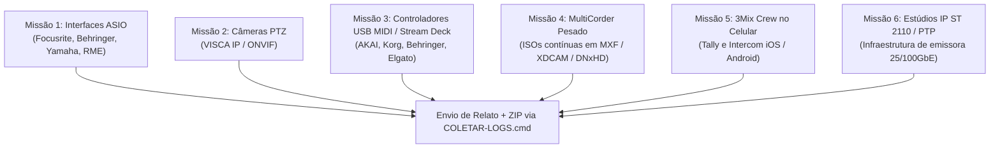

# 3MIX PRO — CHAMADO À COMUNIDADE DE TESTERS ALPHA

> **Versão:** 3Mix Alpha (Gratuita e Aberta para Operadores e Engenheiros Broadcast)  
> **Missão:** Validar estabilidade de transmissão, compatibilidade de hardware físico e ergonomia operacional ao vivo.

---

## 1. MENSAGEM DA ENGENHARIA 3MIX

Operadores, diretores de TV, técnicos de streaming e engenheiros de transmissão:

O **3Mix** foi concebido desde a primeira linha de código para ser uma suíte broadcast de produção ao vivo profissional, modular e com tolerância zero a falhas. Ele não é uma skin de OBS nem um clone jurássico do vMix — sua interface unificada no padrão **grafite MotionCaster** foi desenhada para operações de missão crítica.

Durante o desenvolvimento interno, comprovamos rigorosamente a matemática de áudio, os pipelines de vídeo, o roteamento lógico de M/Es, DSKs, transições, layouts virtuais e a segurança do sistema com mais de **200 testes automatizados locais**.

Porém, software de transmissão de alta fidelidade depende da interação com o mundo físico: cabos, placas de rede de alta velocidade, consoles de áudio, câmeras com motores mecânicos e dispositivos móveis na mão dos operadores. **É aqui que a comunidade entra.**

Nesta fase Alpha, o software é **100% gratuito e liberado** para que vocês estressem todas as engrenagens em estúdios, igrejas, arenas, emissoras e produtoras.

---

## 2. O QUE JÁ ESTÁ PRONTO E LIBERADO PARA VOCÊS USAREM

| Módulo | Recursos Prontos para Operação |
|---|---|
| **3Mix Chroma** | Keyer profissional com conta-gotas de precisão, supressão de spill ajustável, visualização em checkerboard para conferir transparência, comparação A/B e compatibilidade com shaders de recorte fino. |
| **3Mix Virtual Studio** | Cenários virtuais 2D e 2.5D, ajuste fino de perspectiva, presets de enquadramento de câmera, zoom virtual suave por software, suporte a múltiplas câmeras em posições independentes e conector UDP nativo **FreeD** para estúdios 3D externos (Unreal Engine). |
| **3Mix Social** | Central de moderação ao vivo com busca e aprovação em tempo real, comentários do YouTube, Twitch e TikTok, ativação com 1 clique nos DSKs 1 a 4 e templates HTML5 animados de Lower Third. |
| **3Mix Crew** | Tally e Intercom móvel para a equipe técnica no celular (`/crew`): tela no celular com Programa (vermelho), Preview (verde), botão PTT (segurar para falar) e prioridade da direção, com pareamento rápido por **QR Code dinâmico**. |
| **MultiCorder Multi-SSD** | Gravação independente por câmera (ISO) com suporte a contêineres **MXF OP1a** e **MOV**, detecção física de SSDs/NVMes para alertar colisão de gravação e telemetria de vazão em tempo real (MB/s e GB/h). |
| **Automação & Protocolos** | Controle nativo via Bitfocus Companion / protocolo **OSC 1.0** na porta 18188, comandos MIDI, suporte a fluxos **SRT**, **NDI / OMT**, e bridge vMix TCP segura em loopback. |

---

## 3. MISSÕES DE TESTE — O QUE PRECISAMOS QUE VOCÊS TESTEM

Pedimos que os testers da comunidade escolham uma ou mais missões abaixo, de acordo com o equipamento disponível no seu estúdio:



---

### MISSÃO 1: Interfaces de Áudio Profissional (ASIO Físico)
- **Equipamentos desejados**: Interfaces USB/Thunderbolt Behringer (U-Phoria), Focusrite (Scarlett/Clarett), PreSonus, Yamaha/Steinberg, RME, MOTU, Audient ou mesas digitais USB (X32, M32, TF, Wing, SQ).
- **O que testar**:
  1. Conectar a interface, abrir o 3Mix e verificar a enumeração do driver no menu de áudio.
  2. Testar gravação e transmissão por 1 a 2 horas contínuas em 48 kHz.
  3. **Teste de Resiliência (Hotplug)**: Com o 3Mix em execução, desconectar o cabo USB da interface, aguardar 5 segundos e reconectar. O driver volta a responder ou requer reinício do app?
  4. Observar se ocorre *drift* de sincronismo áudio/vídeo ou estalidos (*crackling*) com buffers baixos (64/128/256 samples).

---

### MISSÃO 2: Câmeras Robóticas PTZ (VISCA sobre IP e ONVIF)
- **Equipamentos desejados**: Câmeras PTZ das marcas PTZOptics, Birddog, Sony, Panasonic, Datavideo, Avonic, ZCam ou câmeras IP de segurança com ONVIF Profile S.
- **O que testar**:
  1. Abrir a janela de controle PTZ no 3Mix (`/ptz` ou botão na barra).
  2. Configurar o IP da câmera e testar a movimentação suave (Pan, Tilt, Zoom, Foco manual).
  3. Salvar 4 presets de enquadramento e disparar o recall entre eles. O movimento é suave e preciso?
  4. Simular queda de rede (desconectar o cabo de rede da câmera por 10 segundos). O 3Mix reconecta sozinho sem travar o painel?

---

### MISSÃO 3: Superfícies de Controle Físico (USB MIDI e Stream Deck)
- **Equipamentos desejados**:
  - Mesas USB MIDI: AKAI APC Mini, Korg nanoKONTROL, Behringer X-Touch Mini, Novation Launchpad.
  - Elgato Stream Deck (via Bitfocus Companion).
- **O que testar**:
  1. Mapear botões físicos para comandos de corte: **CUT**, **AUTO**, seleção de Preview/Program.
  2. Mapear um fader analógico para o T-Bar de transição ou controle de volume do Master.
  3. Mapear botões de acionamento de DSK 1 a 4 e Talkback do Diretor.
  4. Conferir a latência do disparo físico: o corte na tela é instantâneo?

---

### MISSÃO 4: Gravação MultiCorder Pesada em SSDs / NVMes (Estresse Real)
- **Equipamentos desejados**: Computador com 2 ou mais SSDs (SATA ou NVMe) e pelo menos 4 entradas de vídeo simultâneas (HDMI, SDI, NDI ou USB).
- **O que testar**:
  1. Abrir a janela **Multigravação (ISO)**.
  2. Atribuir cada câmera para uma pasta em um SSD físico diferente (ex: CAM 1 no `C:\Gravacoes`, CAM 2 e 3 no `D:\Gravacoes`). O 3Mix deve indicar os nomes físicos reais dos discos e avisar de colisões.
  3. Escolher o formato broadcast **MXF OP1a** com perfil **Sony XDCAM HD422 (50 Mbps)** ou **Avid DNxHD 145/220**.
  4. Gravar continuamente por **60 minutos**.
  5. **Verificação nos NLEs**: Importar os arquivos `.mxf` gerados diretamente no **Adobe Premiere Pro**, **DaVinci Resolve**, **Avid Media Composer** e **Final Cut Pro**. O vídeo e áudio abrem perfeitamente sem necessidade de transcodificação?

---

### MISSÃO 5: 3Mix Crew no Celular (Tally e Intercom Operacional)
- **Equipamentos desejados**: Celulares iPhone (iOS com Safari) e celulares Android (Chrome) conectados na mesma rede Wi-Fi do 3Mix.
- **O que testar**:
  1. Abrir a rota `/crew` no computador e apontar a câmera do celular para o **QR Code** exibido.
  2. Selecionar a câmera atribuída ao cinegrafista.
  3. Conferir o **Tally visual**: a tela do celular fica vermelha em Programa e verde em Preview? A legibilidade sob luz de estúdio é satisfatória?
  4. Testar o botão **Segurar para Falar (PTT)** do Intercom:
     - O diretor consegue falar com o cinegrafista com baixa latência?
     - Quando o diretor fala, as outras vozes são atenuadas para prioridade da direção?
     - O áudio do intercom vaza para a transmissão de Programa (PGM)? *(Não deve vazar em hipótese alguma!)*

---

### MISSÃO 6: Infraestrutura SMPTE ST 2110 / PTP (Emissoras e Caminhões OB)
- **Equipamentos desejados**: Servidores equipados com placas de rede de alta velocidade (NVIDIA Mellanox ConnectX-5/6/7 ou Intel E810 de 25/100 GbE) conectadas a switches com PTP Boundary Clock.
- **O que testar**:
  - Avaliar as especificações descritas no documento [`3mix-panel/docs/ARQUITETURA-ST2110-NMOS.md`](file:///D:/DRIVE/IA/antigravity/3Mix/3mix-panel/docs/ARQUITETURA-ST2110-NMOS.md).
  - Testar recepção de áudio ST 2110-30 (AES67) sincronizado ao PTP Grandmaster (Domain 127).

---

## 4. COMO ENVIAR SEU FEEDBACK E PACOTE DE DIAGNÓSTICO

Se você encontrou um bug, comportamento inesperado ou tem sugestões de ergonomia operacional:

### Passo 1: Gerar o Pacote de Diagnóstico
Você não precisa copiar arquivos manualmente. Use o script automatizado na raiz da pasta do 3Mix:

```bat
COLETAR-LOGS.cmd
```

Ou, com o 3Mix aberto, clique em **Relatar problema…** na mesa de corte.

O script gera um arquivo ZIP na pasta `diagnosticos/` (ex: `3mix-diagnostico-20261103-XXXXXX.zip`).

### Passo 2: O Que Escrever no Relato
Junto com o arquivo ZIP, informe:
1. **Missão testada** (ex: Missão 1 - Interface Focusrite Scarlett 18i20).
2. **Especificações do seu PC**: Processador, memória RAM e placa de vídeo (GPU).
3. **O que aconteceu**: O passo a passo exato do que você executou.
4. **Comportamento observado**: O erro que apareceu na tela ou o sintoma percebido.
5. **Comportamento esperado**: Como você gostaria que o switcher se comportasse.

### Garantia de Privacidade
O coletor de logs do 3Mix possui um filtro de redação automático estrito:
- **NUNCA inclui**: senhas, chaves de stream, tokens de autenticação, vídeos, capturas de tela ou gravações de áudio.
- **INCLUI apenas**: versão do software, modelo de GPU/CPU, taxa de quadros e logs de erro da engine.

---

*A equipe do 3Mix agradece imensamente a dedicação de cada profissional de transmissão que está ajudando a construir o mais moderno switcher broadcast independente.*


## Homologação adicional vMix 30 — gates comuns

Estas missões preservam as seis missões anteriores. Executar fora de produção. Antes de testar: registrar versão/hash do pacote, Windows, GPU/driver, modelo/firmware e topologia; confirmar que o motor instalado enumera a capacidade. Opção ausente significa **não disponível no pacote**, não suporte aprovado. Código e mock não são homologação física. Não instalar DLLs não autorizadas nem enviar chaves, passphrases ou URLs autenticadas.

Estados: Compatibilidade prevista; Implementado sem teste físico; Em homologação Alpha; Homologado com evidência; Incompatível; Não testado. Um recurso sem integração operacional permanece pendência de engenharia.

### MISSÃO 7 — DeckLink SDI, 10 bits e áudio multicanal

- **Equipamento:** DeckLink identificada por modelo/revisão; gerador de padrão e receptor/analisador SDI capaz de confirmar bits e canais.
- **Driver e sistema:** Desktop Video compatível com o modelo e Windows do pacote; registrar versões, sem supor mínimo universal.
- **Configuração do 3Mix:** Central de Saídas → SDI: atualizar dispositivos, selecionar modo enumerado, conteúdo e barramento disponíveis. Profundidade, HDR e 16 canais são capacidades distintas.
- **Passos:** Testar padrão em 8 bits e repetir em 10 bits somente quando negociado; identificar separadamente cada canal disponível; trocar Programa/entrada/M/E já configurado e barramento; testar porta ocupada e inicialização sem placa.
- **Resultado esperado:** Modo e conteúdo confirmados no receptor, áudio correto, incompatibilidades recusadas. Se o caminho expuser apenas estéreo, multicanal fica indisponível, não homologado.
- **Falhas, logs e evidências:** Modo solicitado/observado, conector, driver/firmware, vídeo de padrão, captura do analisador e diagnóstico sanitizado do motor; ensaio de 30 minutos. Imagem visível sozinha não comprova 10 bits.

### MISSÃO 8 — Captura AJA e compatibilidade de modelos

- **Equipamento:** AJA IP25, KONA X ou Corvid 88 Gen 3, fonte e infraestrutura adequadas ao modelo.
- **Driver e sistema:** Confirmar primeiro suporte no SDK/plugin/driver distribuído e licença; se ausente, registrar bloqueio de engenharia. Plugin genérico não comprova o modelo.
- **Configuração do 3Mix:** Enumerar captura/saída AJA existente, usando apenas conectores e modos oferecidos.
- **Passos:** Abrir sem placa para verificar diagnóstico; com placa, capturar padrão/áudio, testar modos enumerados, perda/retorno de sinal e reabertura; simultaneidade apenas quando anunciada pela capacidade.
- **Resultado esperado:** Modelo e modo reconhecidos, recuperação clara e sincronismo estável. Não generalizar um ensaio para toda família AJA.
- **Falhas, logs e evidências:** Modelo/revisão, SDK/driver/firmware, mapa de conexões, horário e logs AJA/3Mix sanitizados; gravação e relatório de 30 minutos.

### MISSÃO 9 — NDI entre computadores e múltiplos emissores

- **Equipamento:** Dois PCs e rede cabeada dimensionada; receptor NDI identificado e padrões distintos.
- **Driver e sistema:** Registrar plugin/SDK compilado e runtime carregado em ambas as pontas; runtime observado 6.3.2.0 não identifica SDK.
- **Configuração do 3Mix:** Central de Saídas → NDI: nomes únicos, conteúdo e áudio por sender; não alterar 3Mix IO.
- **Passos:** Receber cada sender no segundo PC; aumentar concorrência dentro dos limites reais; desligar um sender, interromper rede e recuperar; medir drops e sincronismo por 30 minutos.
- **Resultado esperado:** Fontes e áudio corretos, falhas isoladas e recuperação observável. Discovery não comprova vídeo estável. MKV/metadados só testar se houver caminho integrado e licenciado, com roundtrip.
- **Falhas, logs e evidências:** Topologia, NIC/velocidade, versões, nomes sanitizados, CPU/GPU/drops e logs das duas pontas; trechos de vídeo com horário.

### MISSÃO 10 — SRT avançado e transmissão entre redes

- **Equipamento:** Duas máquinas/redes e receptor SRT conhecido; endpoint autorizado de plataforma opcional.
- **Driver e sistema:** Registrar biblioteca efetivamente usada, firewall/NAT e portas; nunca compartilhar segredos.
- **Configuração do 3Mix:** Usar transporte existente; Caller/Listener/Rendezvous somente quando expostos; explicitar unidade da latência nas duas pontas.
- **Passos:** Caller→Listener, inverter papéis, Rendezvous quando viável; variar latência fora do ar; interromper conexão e medir reconexão; validar áudio/sync e plataforma autorizada. Perdas induzidas só em laboratório autorizado.
- **Resultado esperado:** Sinal correto e erros distinguíveis; reconexão sem duplicação. Estatística ausente não significa perda zero. Plataforma e contribuição ponto a ponto precisam de ensaios separados.
- **Falhas, logs e evidências:** Topologia sanitizada, modo, latência, tempo de recuperação, estatísticas disponíveis e logs das duas pontas; vídeo antes/depois e horários.

### MISSÃO 11 — Desentrelaçamento e saídas físicas de vídeo

- **Equipamento:** Fontes/padrões 1080i, 576i e 480i, captura e monitor/analisador apropriados; marcador A/V.
- **Driver e sistema:** Drivers e modos enumerados, taxa racional e ordem de campos conhecidas; não confundir campos/s com quadros/s.
- **Configuração do 3Mix:** Selecionar fonte nativa de captura, ordem de campo e método exposto; usar saída física já implementada.
- **Passos:** Para cada formato: comparar desligado/ligado em movimento, conferir ordem superior/inferior, taxa real, drops e offset A/V; salvar/reabrir e repetir perda/retorno de sinal.
- **Resultado esperado:** Movimento e ordem corretos, sincronismo medido e taxa confirmada. Captura desentrelaçada não prova saída entrelaçada; saída ausente fica indisponível.
- **Falhas, logs e evidências:** Formato/taxa/ordem/método, offset A/V e drops, vídeo antes/depois, captura do analisador e diagnóstico sanitizado. Homologar separadamente cada formato.

---

### MISSÃO 12 — Estúdio Virtual Unificado (Câmera, Zoom e Presets)

- **Equipamento:** Entrada de vídeo ao vivo (Câmera HDMI/SDI ou NDI/Webcam recortada por Croma Key) e tela de alta resolução para conferência visual dos quatro planos de profundidade.
- **Configuração do 3Mix:** Criar ou selecionar um Input configurado como Estúdio Virtual (`Virtual Set`). Conectar a câmera ao slot Z=2 (Apresentador), Z=0 (Telão de fundo), Z=1 (Cenário 3D) e Z=3 (Bancada/Mesa frontal).
- **Passos de reprodução:**
  1. No card da entrada na Mesa de Corte, inspecionar a coluna lateral de enquadramentos de câmera (botões `1 GERAL`, `2 MÉDIO`, `3 CLOSE`, `4 TELÃO`).
  2. Acionar a transição de câmera de `GERAL` (1.0x) para `MÉDIO` (1.45x) e `CLOSE` (2.05x).
  3. Ajustar as velocidades de transição (`F` Rápido, `M` Médio, `S` Lento, `C` Cut instantâneo).
  4. Observar a movimentação em tempo real no monitor de Preview e PGM.
- **Critérios de aprovação:**
  - Todas as 4 camadas devem escalar e transladar em bloco rigorosamente sincronizado, sem descolamento de perspectiva entre o apresentador e a bancada.
  - A transição dinâmica de câmera deve respeitar o tempo configurado (ex: 1.5s em Slow) com aceleração e desaceleração suaves (curva sinusoidal de easing).
  - O corte instantâneo (`Cut`) deve saltar de posição imediatamente sem flicker ou quadros pretos.

---

### MISSÃO 13 — Apresentações de Slides Nativos (Vetor SVG com Cache-Busting)

- **Equipamento:** Qualquer estação Windows com saída secundária de vídeo (Projetor, LED Wall ou retorno de palco/confiança).
- **Configuração do 3Mix:** Adicionar entrada do tipo `Apresentação de Slides` através do painel de criação de entradas ou via API `/api/slides`.
- **Passos de reprodução:**
  1. Carregar um arquivo de slides ou conjunto de tópicos com bullets animados.
  2. Navegar entre slides usando atalhos de teclado (Next/Prev) ou o painel remoto `/remoto/slides.html`.
  3. Acionar o avanço progressivo de bullets (revelação sequencial de tópicos).
  4. Modificar o texto ou a formatação de um slide em tempo real durante a execução.
- **Critérios de aprovação:**
  - O slide deve renderizar com nitidez vetorial perfeita na resolução nativa de PGM (1080p ou 4K), sem artefatos de compressão de bitmap.
  - O avanço de tópicos deve revelar os itens com transição de opacidade limpa.
  - As atualizações de conteúdo devem refletir imediatamente no navegador de cena OBS sem reter cache antigo (validação do parâmetro de cache-busting `?t=timestamp`).

- **Equipamento:** Fontes/padrões 1080i, 576i e 480i, captura e monitor/analisador apropriados; marcador A/V.
- **Driver e sistema:** Drivers e modos enumerados, taxa racional e ordem de campos conhecidas; não confundir campos/s com quadros/s.
- **Configuração do 3Mix:** Selecionar fonte nativa de captura, ordem de campo e método exposto; usar saída física já implementada.
- **Passos:** Para cada formato: comparar desligado/ligado em movimento, conferir ordem superior/inferior, taxa real, drops e offset A/V; salvar/reabrir e repetir perda/retorno de sinal.
- **Resultado esperado:** Movimento e ordem corretos, sincronismo medido e taxa confirmada. Captura desentrelaçada não prova saída entrelaçada; saída ausente fica indisponível.
- **Falhas, logs e evidências:** Formato/taxa/ordem/método, offset A/V e drops, vídeo antes/depois, captura do analisador e diagnóstico sanitizado. Homologar separadamente cada formato.

---

### MISSÃO 14 — Gerenciador de Plugins OBS (somente após entrega de build integrada)

- **Estado:** roteiro de homologação Alpha; o código, os testes automatizados e a presença de uma DLL não comprovam carregamento e operação no pacote entregue. Executar em uma cópia de QA, com o tema e a configuração fechada do 3Mix conferidos antes de abrir o aplicativo, nunca durante transmissão ou gravação ativa.
- **Base sem hardware especial:** Windows x64; versão e SHA256 do 3Mix, libobs e ZIP do plugin; origem oficial, licença e dependências identificadas. Preferir um plugin compatível que registre um filtro ou Input simples. Não executar instalador EXE.
- **Passos:** Instalar o ZIP pela seção Configurações → Plugins; confirmar que a ação fica pendente até reiniciar; reiniciar só a instância de QA; conferir no log o módulo carregado, o recurso registrado e seu uso na Mesa; desabilitar e reiniciar; confirmar ausência do recurso; habilitar e reiniciar; atualizar com backup, executar rollback e conferir a versão anterior; remover e confirmar preservação de projetos/configurações. Repetir com ZIP incompatível, DLL x86, caminho `../` e tentativa de sobrepor módulo essencial, que devem ser recusados antes de executar qualquer código.
- **Recuperação:** Provocar falha apenas na instância de QA com fixture autorizada, verificar identificação do último plugin alterado e iniciar o modo de segurança sem carregar terceiros. Registrar se o 3Mix continua abrindo e se o projeto original permanece íntegro.
- **Hardware específico:** Para plugins de captura AJA/DeckLink, ASIO, NDI, GPU ou controle externo, registrar modelo/revisão, driver/SDK/runtime, firmware, conexões e recursos efetivamente enumerados. Testar sinal, áudio, reconexão e duração por equipamento. Sem o hardware ou dependência correta, classificar como **não homologado naquele equipamento**; o tester não deve suprir integração de engenharia ausente.
- **Evidência:** Capturas da seção Plugins e do recurso na interface 3Mix, logs sanitizados de cada início, hash dos pacotes, versões antes/depois, resultado do rollback, inventário de Inputs/filtros/transições/encoders/outputs e estado de PGM/Preview, M/Es, DSKs e saídas antes/depois. Relatar separadamente interface Qt/dock próprio que exija adaptador.
